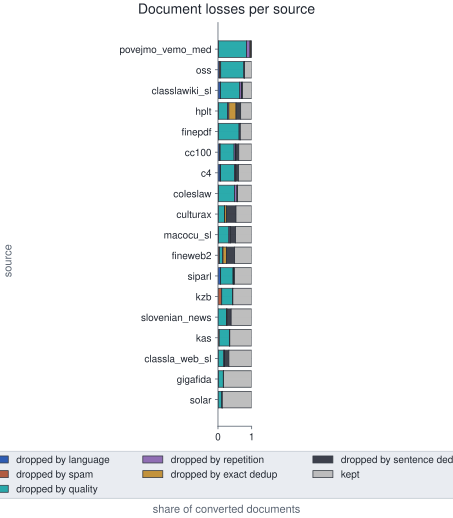

# Curation filter thresholds — Slovenian

## TL;DR

- **Hypothesis**: open — whether settings chosen per source let each content filter drop mostly what it targets, and mostly bad text, on a draw held back from tuning.
- **Where we stand**: the judge's agreement with the person stays below the agreement gate on both judged draws, so no clause can be called yet ([F9]). Loosening the quality and repetition settings per route, on the evidence of both draws, gained about the good text it was estimated to gain ([F10]). What the loosened quality filter still drops is mostly bad text, while most repetition drops are still good text ([F11]).
- **Next**: the open amendment of the hypothesis, read on one judge whose agreement with the person stays below the gate; no second judge is run ([D3]).

## Hypothesis

- **Builds on**: the curation-quality experiment (curation-quality-slovenian) found that every content filter drops mostly text worth keeping. It also found that how well a filter decides swings with the source. It measured the pipeline without changing it, and left the repair to this experiment.
- **Statement**: Once each source takes its own route through the content filters, with retuned thresholds, each filter mostly drops the text it is built to catch. The spam, quality and repetition filters then also mostly drop bad text, on a fresh draw held back from tuning.
- **Rationale**: the earlier audit points to settings, not to the filters themselves.
  - **The filters sort in the right direction.** In the earlier audit, kept text beat dropped text at every content filter when the judge compared them in pairs. The filters are miscalibrated, not inverted.
  - **Their failures sit on particular sources.** The spam filter drops mostly real spam on the raw web crawls and mostly clean prose on curated sources. The quality and repetition filters decide at about a coin flip on the medical and academic sources.
  - **The causes are known and fixable.** Parliamentary rebuttals hit a spam term, and patient leaflets repeat dosage lines by design. Gopher's thresholds were tuned on English web text, not on Slovene curated prose.
- **Predictions**: every clause is read on the fresh draw, judged only after the thresholds are frozen. A rate is read pooled over sources, and on each source the filter still runs on with at least 20 judged drops. Each filter is judged on its own target ([D1]): the language filter on non-Slovene text, the spam filter on spam, the quality filter on ill-formed text, the repetition filter on repeated furniture.
  - **H1 — The language filter drops text that is not Slovene**: confirmed if at least 0.6 of its drops are judged not Slovene, pooled and on every source; refuted if any rate falls below 0.5 — the filter would be removing Slovene text.
  - **H2 — The spam filter drops spam**: confirmed if at least 0.6 of its drops are judged adult or spam, pooled and on every source it runs on; refuted if any rate falls below 0.5 — routing and the repaired term list would not have fixed it.
  - **H3 — The quality filter drops ill-formed text**: confirmed if at least 0.6 of its drops score coherence 2 or lower or are labelled garbage, pooled and on every source; refuted if any rate falls below 0.5 — its floors would still misread Slovene prose.
  - **H4 — The repetition filter drops repeated furniture**: confirmed if at least 0.6 of its drops are labelled boilerplate or garbage, pooled and on every source; refuted if any rate falls below 0.5 — its limits would still catch text that repeats by design.
  - **H5 — The spam, quality and repetition filters drop bad text**: confirmed if each one's drop precision at the lenient bar is at least 0.6, pooled and on every source it runs on; refuted if any falls below 0.5 — a filter could hit its target and still discard usable text.
  - **Verdict rule**: confirmed when all five clauses hold; refuted when any clause is refuted; inconclusive otherwise.
  - **Read beside the clauses, not as clauses**: the share of bad text among kept documents per stage; retention per source, with the medical, scientific, legal and parliamentary sources called out; the corpus total against KPI 3 and the medicine and science totals against KPI 4 ([D4]); per-domain counts at every stage from the document-level domain classifier of the planned KPI coverage experiment, once it exists.
- **Outcome**: open

## Design

- **Inputs**: the curated corpus rebuilt under each candidate route, the earlier audit's judged sample and hand labels for tuning, and a fresh draw for validation, described in `## Datasets`.
- **Method / factors**: one tuning pass on old evidence, one validation pass on new evidence.
  - Restate the earlier audit's per-source baseline from the rebuilt corpus, since five sources were counted twice there.
  - Give each source one of three routes through the content filters, a starting point taken from the earlier audit's per-source numbers.
  - Tune the thresholds of each route against the earlier judge verdicts and hand labels.
  - Freeze the thresholds, rebuild the corpus, and draw a fresh sample under a new seed.
  - Judge the fresh draw with the earlier rubric.
  - Factors: the route each source takes, the Gopher quality and repetition floors, the language-identification threshold, and the spam thresholds on the repaired spam signal. The dedup stages stay fixed.
- **Metrics**: primary target precision per content filter and source, and drop precision at the lenient bar for the spam, quality and repetition filters. Secondary: residual bad rate, retention per source, corpus and domain totals in estimated tokens, and Cohen's κ between the judge and the person. Each metric is defined in `experiments/GLOSSARY.md`.
- **Protocol**: analysis-only for the judging: `analysis.py` recomputes every table from the corpus counts and the verdict files. Each corpus rebuild logs to MLflow: the baseline under `slm4ie/data/curate`, since it is the shared corpus, and each candidate build under `slm4ie/data/curation-thresholds-slovenian`. Findings rest on one judge run, and its agreement with the hand labels is read on that same run ([D3]).
- **Compute**: one local machine with 40 cores; each candidate rebuild reruns only the units whose effective settings changed.
- **People**: the project lead reviews the routes; no new hand labels are planned.
- **Data access**: four licence-restricted sources (culturax, gigafida, kas, solar) are used internally, as in the earlier audit.
- **External dependency**: Anthropic's Claude for the judge.

## Datasets

- **Baseline corpus**: the shared pretraining corpus rebuilt with the pipeline as it stands on main ([D5], the baseline build), one row per source with its domain, kind, licence and size before and after curation. Built 2026-10-05 to 2026-10-08 at commit 2ece205 from 18 Slovene sources. [Sources of the baseline corpus, before and after curation](tables/dataset-corpus-statistics.csv)
- **Candidate-routes build**: the same 18 sources rebuilt with every source on its route ([M1]) and the letter rule repaired ([M2]), in this experiment's own data folder ([D6]). The second candidate of the tuning pass, with the curated-prose quality settings of [D9], built 2026-10-12 to 2026-10-14 at commit 4425f23. It replaced the first candidate, built 2026-10-08 to 2026-10-11 at commit a03f2dd from the baseline's converted documents, whose counts stay in MLflow. [Documents per source at each stage of the candidate-routes build](tables/curation-routes-documents-by-source.csv)

## Methods

### M1 — Send each source through one of three routes of filter settings

- **Input**: the 18 selected Slovene sources, each a set of documents converted from its extracted text. One item is a source with its name, such as `gigafida`.
- **Output**: per source, the settings each content filter applies to its documents. They drive the language, spam, quality and repetition filters of every candidate build.
- **How**: a route is a named set of content-filter settings that every source of one kind shares.
  1. Assign each source to a route by how the earlier audit's filters fared on it. Seven web crawls take the raw-crawl route. Seven edited-text sources (wiki, legal, reference corpus, parliament, news, student essays, and the crawl of PDF documents) take the curated-prose route. The four medical and academic sources take the medical-and-academic route.
  2. Start from the shared pipeline's settings, with the quality filter's letter rule counting only tokens that are not punctuation ([M2]). The raw-crawl route changes nothing else.
  3. On the curated-prose route, switch the language and spam filters off and widen every repetition limit by half. Lower the letter floor of the quality filter from 0.8 to 0.55 ([D9]).
  4. On the medical-and-academic route, switch the spam filter off and keep the language filter. Widen the repetition limits by half, and double the limits on repeated lines.
  5. Merge a source's own settings over its route's. The news source skips the rule on lines ending in an ellipsis ([D9]). The PDF crawl keeps the language filter on.
  6. For the loosened build, which goes to its own folder beside the frozen one, apply the per-route changes chosen on the judged samples ([D16]). Raw crawls switch off the rule on lines ending in an ellipsis and the limits on repeated 5- to 10-word phrases. Curated prose lowers the 20-word floor to 10 and switches the stopword rule and the repetition filter off. Medical and academic text switches the repetition filter off.
- **Code**: `slm4ie/data/curate/config.py::resolve_profiles`
- **Settings**: `profiles` (the three routes, each a set of filter settings), `overrides` (the route each source takes, and its own settings on top), `max_non_alpha_words_ratio` (minimum share of words containing a letter), `max_ellipsis_lines_ratio` (maximum share of lines ending in an ellipsis; 0 switches the rule off), `min_doc_words` (fewest words a document may have), `min_stop_words` (fewest stopwords a document must contain; 0 switches the rule off), `dup_line_frac` (maximum share of lines repeated in the document), `top_n_grams` (maximum share of characters covered by the most frequent word pair, triple and quadruple), `dup_n_grams` (maximum share of characters inside repeated 5- to 10-word sequences; an empty list switches the rule off), `enabled` (whether a filter runs on the source at all); in `configs/curation-routes.yaml`, and for the loosened build in `configs/curation-routes-loosened.yaml`

### M2 — Count only words, not punctuation marks, in the quality filter's letter rule

- **Input**: one document reaching the quality filter, as plain text. The filter's settings come from the document's route ([M1]).
- **Output**: the document kept or dropped, with the first rule it failed. Kept documents go on to the repetition filter.
- **How**: the quality filter applies the Gopher heuristics, rule-based checks published with DeepMind's Gopher model. One of them requires most words to contain a letter, which is meant to catch tables of numbers and symbol junk.
  1. Split the text into tokens with datatrove's Slovene word splitter, which makes every punctuation mark its own token.
  2. Set aside the tokens made only of punctuation. The length and word-length rules already read only the remaining tokens.
  3. Apply every other Gopher rule unchanged, in datatrove's order.
  4. Compute the letter share over the remaining tokens, $s = a / w$, where $w$ is the number of tokens that are not pure punctuation and $a$ is how many of them contain a letter. Drop the document when $s$ is below the floor.
- **Code**: `slm4ie/data/curate/stages/quality.py::LetterShareGopherQualityFilter`
- **Settings**: `max_non_alpha_words_ratio` (the floor on the letter share, 0.8), `alpha_words_skip_punctuation` (whether punctuation tokens are set aside before the letter share is taken); in `configs/curation-routes.yaml`

### M3 — Score each content filter's drops on its own target and on bad text

- **Input**: a judged sample of documents, each with its source, the filters that kept or dropped it, and one judge verdict. A verdict gives the language, a coherence score from 1 to 5, a text type such as prose, boilerplate or garbage, and an adult-or-spam flag.
- **Output**: one row per filter, pooled over sources and then per source, with the target precision and the drop precision at the lenient bar. Each rate carries its Wilson interval and its call against the record's bars ([D2]). Written to `tables/audit-precision-by-filter-and-source.csv` for the earlier audit's sample.
- **How**: each filter is scored only on the documents it dropped.
  1. Keep the documents from the 18 selected sources that a content filter dropped and the judge read. A document dropped by one filter counts only for that filter.
  2. Mark a drop as on target by the filter's own test ([D1]). Language: the judge does not call it Slovene. Spam: flagged adult or spam. Quality: coherence 2 or lower, or garbage. Repetition: boilerplate or garbage.
  3. Mark a drop as bad text when it has coherence 2 or lower, is garbage or boilerplate, or is flagged adult or spam. The language filter is not scored on bad text.
  4. For a filter and a group of drops, compute the precision $p = h / n$, where $n$ is the number of judged drops in the group and $h$ how many pass the test, with its 95% Wilson interval.
  5. Pool by concatenating every source's drops, so each source weighs by its judged drops, not by its volume.
  6. Call a rate "holds" at 0.6 or more, "fails" below 0.5, and "open" between. A source with fewer than 20 judged drops gets no call.
- **Code**: `analysis.py::precision_rows`
- **Settings**: none; the bars are the record's ([D2])

### M4 — Re-apply a candidate's quality filter to the documents the earlier audit saw it drop

- **Input**: the documents from the 18 selected sources that the quality filter dropped in the earlier audit's judged sample, each with its judge verdict. One item is such a document, with its source.
- **Output**: per source, per route and pooled, how many of those documents the candidate's quality filter now keeps, the share of them that is bad text, and the target and bad-text precision of the ones it still drops ([M3]). Written to `tables/curation-routes-audit-quality-refilter-by-route-and-source.csv` for the candidate-routes build.
- **How**: the judge read only each document's opening, so the filter is re-applied to the full text.
  1. Read each document's full text from the candidate build's input to the quality filter, matching the opening the judge read. A document is counted once even when the sample lists it twice, so a source can show fewer documents here than drops in the earlier audit's scoring ([M3]).
  2. Leave out, and count apart, two kinds of document. One is absent from that input, because an earlier filter of the candidate build drops it or because its source's document ids changed since the audit's build. The other is present only with text that no longer starts with the judged opening, so its verdict does not describe it.
  3. Build each source's quality filter with its route's settings and its own on top ([M1]), including the repaired letter rule ([M2]).
  4. Run the filter on each document. A kept document is rescued; the rest are the candidate filter's drops.
  5. Over the rescued documents, compute the share judged bad text, $b = r_{bad} / r$, where $r$ is the number rescued and $r_{bad}$ how many of them are bad text, with its 95% Wilson interval.
  6. Score the documents still dropped on the quality target and on bad text, as for the earlier audit's drops ([M3]). A group with fewer than 20 still dropped gets no call.
- **Code**: `analysis.py::refilter_rows`
- **Settings**: none; the filter settings are the candidate's, in `configs/curation-routes.yaml`

### M5 — List every quality rule each still-dropped document fails

- **Input**: the documents the candidate's quality filter still drops in [M4], each with its judge verdict. One item is such a document, with its source and route.
- **Output**: per route, source and set of failed rules, the first rule failed, how many documents fail exactly that set, and how many of them the judge found to be the quality target or bad text. Each rule is named by the setting that steers it; one setting, the symbol ratio, steers both the hash and the ellipsis rule. Written to `tables/curation-routes-audit-quality-drops-by-rule-and-source.csv`.
- **How**: the quality filter stops at the first rule a document fails, so a document that fails two rules would still be dropped if only the first were loosened.
  1. Run the source's quality filter on the document and note the rule it fails.
  2. Switch that rule off, by setting it to 0 on a copy of the filter, and run it again; repeat until the document is kept.
  3. Group the documents by the set of rules they failed. A set of one rule counts the documents that switching that rule off alone would keep; loosening it only part of the way may keep fewer.
- **Code**: `analysis.py::drop_rule_rows`
- **Settings**: none; the filter settings are the candidate's, in `configs/curation-routes.yaml`

### M6 — Trace the medical source's exact-dedup drops to where their copies come from

- **Input**: the medical source's documents that reach exact dedup in the candidate build, each with the text id its release gives it. Beside them, which of them exact dedup keeps and which reach the finished corpus, the output of sentence dedup. One item is such a document.
- **Output**: one row per origin, with how many documents it holds, their share of the documents entering exact dedup, and how many reach the finished corpus. Written to `tables/curation-routes-medical-exact-dedup-documents-by-copy-origin.csv`.
- **How**: exact dedup keeps one document per distinct text, so each drop has a kept copy somewhere.
  1. Group the documents by their exact text.
  2. A group with no kept document was kept from another source; all its documents count as copies of another source.
  3. Otherwise, every document past the first under one text id is the same record held again; every further text id the text is filed under adds one drop under another text id.
  4. Among the kept documents, one past the first under its text id is a second text of one record. It differs from the first, so exact dedup cannot see it as a copy. In the finished corpus it counts only while its record still has another text there.
- **Code**: `analysis.py::copy_origin_rows`
- **Settings**: none; the source is fixed in the script

### M7 — Read the judge's agreement with the person and call each clause on the fresh draw

- **Input**: one judge run over the fresh draw with the 116 hand-labelled documents spread through it ([D11]). One item is a document with its verdict, and for a hand-labelled document also the person's label on the same rubric.
- **Output**: the judge's agreement with the person per test, the fresh draw's precision per filter and source ([M3]), and a call per hypothesis clause. Written to `tables/curation-routes-fresh-judge-agreement-with-person-by-test.csv`, `tables/curation-routes-fresh-precision-by-filter-and-source.csv` and `tables/curation-routes-fresh-hypothesis-calls-by-clause.csv`.
- **How**: the gate and the findings read the same run ([D3]).
  1. Pair each hand-labelled document's label with the run's verdict on it; a labelled document without a verdict stops the reading.
  2. For each test, bad text at the lenient bar and each filter's target ([D1]), turn both sides into yes-or-no calls and compute Cohen's κ, $\kappa = (p_o - p_e) / (1 - p_e)$, where $p_o$ is the share of documents both call alike and $p_e$ the share chance would give from how often each says yes.
  3. The gate passes when κ on bad text at the lenient bar is at least 0.6. The other tests' κ show which verdict fields the person and the judge read alike.
  4. Score the fresh draw's drops as for the earlier audit's ([M3]). Hand-labelled documents the draw did not hold are left out.
  5. Call a clause confirmed when every rate it reads holds, refuted when any fails, and inconclusive otherwise. H1 to H4 read their filter's target precision; H5 reads bad-text precision on the spam, quality and repetition filters. A rate counts when it is pooled or its source has at least 20 judged drops. Every call carries whether the run passed the gate.
- **Code**: `analysis.py::agreement_rows`, `analysis.py::clause_rows`
- **Settings**: none; the gate and the bars are the record's ([D2], [D3])

### M8 — Estimate how much bad text each filter removes and how much good text it loses on each source

- **Input**: the candidate build's document counts per source after every stage, and the fresh draw's judged drops ([M7]). One item is a filter on a source.
- **Output**: per filter, a pooled row then one row per source, with the documents the filter drops in the whole build, how many of its drops were judged, the share of them estimated bad, the bad documents removed, the good documents lost, a call at the 1:1 rate ([D12]), and whether the judge run passed the agreement gate ([D3]). For the language filter, "bad" in these columns means not Slovene. Written to `tables/curation-routes-fresh-bad-removed-and-good-lost-by-filter-and-source.csv`, most good text lost first within each filter.
- **How**: the draw takes 40 drops per filter and source whatever the source's size, so its shares are scaled back to each source's volume.
  1. The documents a filter drops on a source, $d$, are its count before the filter minus its count after.
  2. The bad share $s$ is the share of the source's judged drops that are bad text at the lenient bar; for the language filter it is the share the judge does not call Slovene ([D1]).
  3. Bad removed is $d \cdot s$, rounded to a whole document; good lost is $d$ minus bad removed.
  4. The pooled row sums $d$ over the sources with judged drops, and its share weighs each source by its drops, $s_{pool} = \sum_i d_i s_i / \sum_i d_i$, where $i$ runs over those sources. A source the draw sampled no drops from is left out of both.
  5. Call a source "keep" when $s \geq 0.5$ and "switch off" below. A source with fewer than 20 judged drops gets no call, nor does the pooled row, since the setting is chosen per source.
- **Code**: `analysis.py::trade_off_rows`
- **Settings**: none; the exchange rate is the record's ([D12])

### M9 — Split each source's quality and repetition drops by the rules they fail, on both judged samples

- **Input**: the judged documents the quality or repetition filter dropped, in the earlier audit's sample and in the fresh draw, from the 18 selected sources ([D13]). One item is such a document with its verdict; a document judged in both keeps its fresh verdict.
- **Output**: per filter, source and set of failed rules, how many judged documents fail exactly that set and how many of them come from the fresh draw, their bad-text share, the documents, bad documents removed and good documents lost that set stands for in the candidate build, and whether the fresh judge run passed the agreement gate ([D3]). Every set is listed, most good text lost first within each filter; which rules to loosen is decided from it in the next step, so no row carries a call. Written to `tables/curation-routes-judged-bad-removed-and-good-lost-by-rule-and-source.csv`.
- **How**: the rules are read on the full text under the candidate's settings, so both samples describe the same build.
  1. Read each document's full text from the candidate build's input to the filter, as for the quality re-score ([M4]); documents absent there, or present with other text, are left out.
  2. Build each source's filter with its route's settings and its own ([M1]).
  3. List every rule the document fails, as for the quality rules ([M5]), each named by the setting that steers it. The repetition filter's line and paragraph limits are switched off one at a time; each of its two n-gram families, the most frequent 2- to 4-word phrase and the repeated 5- to 10-word phrases, is one setting and is switched off whole. A document the candidate filter keeps is left out: it is not one of its drops.
  4. For a source, let $n$ be its judged documents still dropped and $d$ the documents the filter drops there in the build ([M8]). A set failed by $k$ of them, $b$ of which are bad text, stands for $d \cdot k / n$ documents, of which $d \cdot b / n$ are bad removed, each rounded to a whole document, and the rest good lost.
  5. The earlier audit's documents were drawn from its own build's drops; those the candidate still drops count as a sample of the candidate's drops, weighing the same as fresh ones.
- **Code**: `analysis.py::rule_trade_off_rows`, `analysis.py::failing_rules`
- **Settings**: none; the filter settings are the candidate's, in `configs/curation-routes.yaml`

### M10 — Estimate the good and bad text each route's setting changes would keep

- **Input**: the judged quality and repetition drops of both samples with their full text and verdicts, as for the rule breakdown ([M9]), and a list of setting changes per route. One item is a judged document the candidate build drops.
- **Output**: per route and variant, where a variant is one change alone or, on a route with several, all its changes together, a pooled row then one row per source: judged drops, how many of them the variant keeps, the documents it would keep in the build and the bad share of those, how many of those are bad and good, a call at the 1:1 rate ([D12]), and whether the fresh judge run passed the agreement gate ([D3]). Written to `tables/tuning-filter-settings-good-and-bad-kept-by-change-and-source.csv`, most good text gained first within each variant.
- **How**: each change is tried on the documents the candidate build drops, so only what it would rescue is counted.
  1. Merge the change's settings over each source's own ([M1]) and build its quality and repetition filters.
  2. A judged drop is rescued when the variant's filter at that stage keeps it. A quality drop must also pass the variant's repetition filter, the next one it meets. Exact and sentence dedup are not run, so some rescued documents would still be removed there.
  3. Scale as in the rule breakdown: with $n$ judged drops still dropped at a filter on a source, $d$ documents dropped there in the build, and $k$ of the $n$ rescued, $b$ of them bad, the variant keeps $d \cdot k / n$ documents, of which $d \cdot b / n$ are bad, each rounded to a whole document. A source's two filters are summed.
  4. The pooled row sums a route's sources. It is called "adopt" when under half of what it keeps is bad and at least 20 judged drops are rescued, and "reject" otherwise ([D16]); source rows carry no call. The 20 are counted over the route, so a large source may rest on a few of them.
- **Code**: `analysis.py::read_setting_changes`, `analysis.py::rescue_outcomes`, `analysis.py::setting_change_rows`
- **Settings**: `configs/tuning-filter-settings.yaml`: `changes` (per route, each change's `stage`, the filter it loosens, and `settings`, the knobs merged over the route's, where 0 switches a quality rule off and an empty n-gram list switches that repetition family off)

### M11 — Measure the good and bad text the loosened build gained, beside the estimate

- **Input**: the frozen build ([D10]) and the loosened build ([D16]), with document counts per source and stage. Each comes with a judged draw of its quality and repetition drops: the fresh draw for the frozen build, the third draw for the loosened one ([D13]). One item is a judged document one build drops at one of the two filters.
- **Output**: per route, a pooled row then one row per source, most good text gained first. Each row holds the documents gained, bad and good text gained, a 95% interval on bad text gained, and step 10's estimate ([M10]). Written to `tables/curation-routes-loosened-good-and-bad-gained-by-route-and-source.csv`, beside the third run's agreement with the person (`tables/curation-routes-loosened-judge-agreement-with-person-by-test.csv`) and the loosened build's remaining drops scored as in [M8] (`tables/curation-routes-loosened-bad-removed-and-good-lost-by-filter-and-source.csv`).
- **How**: both builds feed the same documents into the quality filter. So what the loosened build gains before dedup is what the frozen build's two filters drop minus what the loosened build's drop.
  1. Each source must enter the quality filter with the same count in both builds, or the reading stops.
  2. A filter its route leaves unchanged must drop the same count in both builds, or the reading stops; it adds nothing and is skipped.
  3. For a changed filter, with $d$ documents dropped in a build and $b$ of its $n$ judged drops bad, it drops $d \cdot b / n$ bad documents. Gains are frozen minus loosened, for documents and for bad text; good text is the rest. A repetition term can be negative, since the loosened build feeds that filter more documents.
  4. The interval on bad text is $\pm 1.96 \sqrt{V}$, with $V = \sum d^2 \tilde p (1 - \tilde p) / n$ over every estimated filter of both builds. Here $\tilde p = (b + 1.92) / (n + 3.84)$, the Agresti–Coull share, so a share of 0 or 1 still counts as uncertain.
  5. Nothing is cut at zero, so a source can show negative bad text by chance; pooled rows sum such noise out.
  6. The estimate beside a route is step 10's variant applying all its changes. It used the fresh draw too, so the comparison tests the loosened side and the counts.
- **Code**: `analysis.py::gain_rows`
- **Settings**: `configs/tuning-filter-settings.yaml` names the filters each route changes; the bad-text bar is [D1]'s lenient bar

## Decisions

### D1 — Judge each filter on what it is built to catch, and the content filters also on bad text

- **Decision**: Each content filter has its own target. Language: the judge says the text is not Slovene. Spam: the judge flags it adult or spam. Quality: coherence 2 or lower, or garbage. Repetition: boilerplate or garbage. The spam, quality and repetition filters are also scored on bad text at the lenient bar. The language filter is not.
- **Why**: Whether a text is Slovene says nothing about its quality, so the language filter cannot be expected to drop bad text. The earlier audit's bar counted non-Slovene drops as bad text, mixing the two.
- **Alternatives**:
  - The earlier audit's single bar for every filter: it blends a filter's purpose with general quality, and hides which one fails.
- **History**:
  - 2026-10-05 first version, at record creation

### D2 — Count a filter as working at 0.6, and as failing below 0.5

- **Decision**: A clause is confirmed at a rate of at least 0.6, pooled and on every source with at least 20 judged drops. It is refuted below 0.5 on any of them.
- **Why**: 0.6 is the line below which the earlier audit called a filter wrong, and the earlier filters sat far below it. 0.8 would likely fail on the spam filter over web crawls even if routing fixes the curated sources.
- **Alternatives**:
  - 0.8, the earlier audit's confirm bar: too ambitious for the spam filter on web crawls.
- **History**:
  - 2026-10-05 first version, at record creation

### D3 — Tune on the old evidence, claim only on a fresh draw

- **Decision**: Thresholds are tuned on the earlier audit's judge verdicts and 116 hand labels. Every claim rests on a fresh draw under a new seed, judged only after the thresholds freeze. The agreement gate is read on the judge run the findings use. No second judge from another model family is run.
- **Why**: Thresholds fitted to one judge's verdicts on one sample stop being neutral evidence. The earlier audit read its gate on one run and its findings on another, which weakened every number it reported.
- **History**:
  - 2026-10-05 first version, at record creation; second judge through OpenRouter, model chosen later by the project lead
  - 2026-10-19 second judge dropped at the project lead's call: a run costs too much for what it would add, since the judged draws already show the dataset's quality; retitled from "… read by two judges"

### D4 — Keep the corpus above the volume targets while tuning

- **Decision**: No setting may push the final corpus below KPI 3, more than 5B estimated tokens, or medicine or science below KPI 4, more than 500k estimated tokens each. Domains are read from source labels. Document-level domain counts from the planned KPI coverage experiment are added beside them once that classifier exists.
- **Why**: Tuning trades kept text against quality, and the project's corpus-size targets bound that trade. Source labels already cover the curated domain sources, so this experiment need not wait for the classifier.
- **History**:
  - 2026-10-05 first version, from the ordering agreed with the KPI coverage experiment

### D5 — Take the baseline from a fresh build of the shared corpus at main's settings

- **Decision**: The baseline is the shared corpus rebuilt with the pipeline as it stands on main: the repaired spam filter, the current source list, and no per-source routes. It is not the earlier audit's build.
- **Why**: The earlier build counted five sources twice and predates the spam repair. Two sources are now skipped as copies of others: parlamint_si inside siparl, legal_mc4 inside c4. Main's settings are no setting of this experiment, so they rebuild the shared corpus.
- **History**:
  - 2026-10-05 first version, after every unit of the on-disk corpus was found out of date

### D6 — Score every candidate setting on a full build of the pipeline

- **Decision**: Each candidate route and threshold set is a full pipeline build, written into this experiment's own data folder and never over the shared corpus.
- **Why**: Dedup across the corpus and the volume targets ([D4]) depend on what every source keeps. Only a full build shows both, so the whole pipeline runs for each candidate.
- **Alternatives**:
  - Rerun only the filters on the earlier audit's judged documents: fast, but blind to dedup and to corpus totals.
- **History**:
  - 2026-10-05 first version, at the project lead's call

### D7 — Switch the language and spam filters off on curated sources

- **Decision**: The curated-prose route runs neither the language nor the spam filter, except that the crawl of PDF documents keeps its language filter. The medical-and-academic route runs no spam filter but keeps the language filter. These sources leave the H1 and H2 clauses for filters they skip ([M1]).
- **Why**: In the earlier audit, none of the 40 judged language drops on any of the six edited-prose sources was judged not Slovene. At most one of 40 spam drops on any curated source was spam ([M3]). These sources are edited Slovene text, so the filters there remove only usable prose.
- **Alternatives**:
  - Keep both filters and raise their thresholds: the wrong language drops are confident calls (Romanian, Dutch, Czech for Slovene), so no confidence threshold separates them.
- **History**:
  - 2026-10-08 first version, as the routes' starting point
  - 2026-10-08 the PDF crawl joins the curated-prose route with its language filter on: in the earlier audit none of its 40 judged spam drops was spam, and 0.375 of its language drops were not Slovene ([M3])

### D8 — Repair the quality filter's letter rule rather than lower its floor

- **Decision**: On every route, the quality filter's rule that most words contain a letter counts only tokens that are not punctuation marks, at the Gopher floor of 0.8 ([M2]).
- **Why**: datatrove splits each punctuation mark into its own word, so comma-dense prose fails a rule meant for numbers and symbols. In the earlier audit's sample, this rule caused most quality drops on nearly every source. With punctuation set aside, those dropped documents had a median letter share of 0.87 to 1.00.
- **Alternatives**:
  - Lower the floor per route, to 0.65: the floor would then track how much punctuation a source uses, not how much junk it holds.
  - Raise the floor on the raw crawls to drop the junk the repair keeps: that junk has the same letter share as good text.
- **History**:
  - 2026-10-08 first version, at the project lead's call
  - 2026-10-12 raw crawls keep the floor at 0.8, at the project lead's call: about one in six audit drops the repair keeps there is junk ([M4]), but no letter floor, stopword share or line measure tested drops it without as much good text

### D9 — Loosen the curated-prose quality filter only where its drops were usable text

- **Decision**: On the curated-prose route, the letter floor drops from 0.8 to 0.55, and the news source skips the rule on lines ending in an ellipsis. The 20-word floor and the stopword rule, first kept, were loosened on the judged samples ([D16]).
- **Why**: The repaired filter still drops 106 of the audit's judged documents here ([M5]). Of these, 39 news teasers fail the ellipsis rule and 16 tables and listings fail the letter rule first; the judge found none of them broken text. Three listings also lack stopwords, and the 32 parliament turns are mostly a few words of procedure; both stayed dropped until the judged samples showed such drops mostly good ([D16]).
- **Alternatives**:
  - Switch the quality filter off on curated prose: it would also keep the number-only PDF tables, at letter shares near 0.2.
  - Lower the 20-word floor for the parliament source alone: the judged samples later favoured lowering it route-wide ([D16]).
- **History**:
  - 2026-10-12 first version, at the project lead's call
  - 2026-10-16 the 20-word floor lowered to 10 and the stopword rule switched off on this route ([D16])

### D10 — Freeze the thresholds of the second candidate build and draw the fresh sample from it

- **Decision**: The thresholds freeze as `configs/curation-routes.yaml` stands at commit 4425f23, the settings of the second candidate build. The fresh draw comes from that build with the earlier audit's sampler settings, 40 documents per source, stage and decision at every stage, under the new seed 20261014.
- **Why**: That build already ran at exactly the frozen settings, so a rebuild would reproduce it ([D6], a full build per candidate setting). Keeping every sampler setting but the seed keeps the fresh verdicts comparable with the earlier audit's, stage by stage, while no document choice rests on the tuning evidence ([D3]).
- **Alternatives**:
  - Sample only the four content filters: about a third less judging, but no fresh reading of the dedup stages beside the audit's.
  - Wait for the medical extraction fix first: it changes one source and its fix lies outside this experiment.
- **History**:
  - 2026-10-14 first version, at the project lead's call

### D11 — Judge the fresh draw with the earlier audit's judge, the 116 hand-labelled documents in the same run

- **Decision**: Sonnet 5 judges the fresh draw on the earlier rubric, through the Claude Code command line in groups of 10, as in the earlier audit. The 116 documents the person labelled are spread evenly through the draw, so each is judged among fresh documents in the run the findings use. They keep their ids, so nothing marks them to the judge; one the draw already holds is judged once.
- **Why**: The same judge keeps the fresh verdicts comparable with the tuning evidence, so only the thresholds change between the two readings. Reading the agreement gate on this very run avoids the earlier audit's split between a calibration run and a findings run.
- **Alternatives**:
  - Sonnet 5.5: possibly closer to the person, but the judge would change along with the thresholds.
  - Opus 5.5: the strongest model, slowest and heaviest on quota, with the same confound.
  - Judge the 116 documents in a run of their own: the gate would again read on a run the findings do not use.
- **History**:
  - 2026-10-15 first version, at the project lead's call
  - 2026-10-19 the 116 documents also spread through the third draw ([D13]), at the project lead's call

### D12 — Keep a filter on a source only where at least half of what it drops is bad text

- **Decision**: One good document lost weighs as much as one bad document removed. A filter, or one of its rules, stays on a source when at least half of the documents it drops there are bad text at the lenient bar, estimated over the source's whole volume.
- **Why**: The fresh draw shows the filters trading good text for bad at very different rates per source. Settings need one exchange rate to be chosen against, and 1:1 is neutral between corpus size and cleanliness. It matches the record's refute line of 0.5 ([D2]).
- **Alternatives**:
  - Two good documents per bad one removed: a cleaner corpus at a large loss of usable text.
  - One good document per two bad ones: favours volume, keeps more spam.
- **History**:
  - 2026-10-15 first version, at the project lead's call

### D13 — Retune on both judged samples, check on a third draw limited to what changed

- **Decision**: The next settings are tuned on the earlier audit's and the fresh draw's verdicts together. The fresh draw thereby becomes tuning evidence. A third draw under a new seed then checks the result, limited to the filters and sources whose settings change.
- **Why**: The fresh draw is the best evidence on the frozen settings, and it shows where they lose good text. Keeping it held back would tune on the older, less informative sample. A third draw restores a check that no setting was tuned on ([D3]).
- **Alternatives**:
  - Tune on the earlier audit's sample only and keep the fresh draw for checking: clean, but tunes on evidence the fresh draw showed to mislead.
- **History**:
  - 2026-10-15 first version, at the project lead's call
  - 2026-10-16 the loosened settings ([D16]) build into their own folder, so the frozen second build stays for comparison, at the project lead's call

### D14 — Leave a learned quality classifier to a follow-up experiment

- **Decision**: This experiment changes only which filters and rules run on each source, and their thresholds. A classifier trained on the judge's verdicts, to catch the spam and boilerplate the rules cannot separate from good text, is left to an experiment of its own.
- **Why**: A classifier changes the pipeline's design and needs its own hypothesis, training data and evaluation. The rule settings can be fixed with the evidence already judged.
- **History**:
  - 2026-10-15 first version, at the project lead's call

### D15 — Keep the Slovenian slices of the multilingual collections in the corpus

- **Decision**: fineweb2, culturax and finepdf stay in the corpus; their bad text is handled by per-source filter settings like any other source.
- **Why**: They are the Slovenian slices of multilingual collections: the language filter drops under 1% of each. Exact and sentence dedup already remove what they share with other sources, and what remains is about 36% of the finished corpus's words, with bad-text shares within the other web crawls' range.
- **Alternatives**:
  - Drop fineweb2 and culturax: loses about 24% of the words, mostly unique web text.
  - Drop all three: loses about 36% of the words, including PDF text no other source holds.
- **History**:
  - 2026-10-15 first version, at the project lead's call

### D16 — Loosen the filters per route, judged on each route's pooled drops

- **Decision**: The changes tried are set per route: on web crawls, the ellipsis-line rule off and the repeated-phrase rule off; on curated prose, the 20-word floor lowered to 10, the stopword rule off and the repetition filter off; on medical and academic text, the repetition filter off. Each route is called on its sources' drops pooled ([M10]).
- **Why**: Tried one at a time, each change kept more good text than bad on its route. Most sources have fewer than 20 rescued judged drops, too few for a call of their own, and routes already group sources by text type ([M1]). The fresh judge run failed the agreement gate, so the calls hold only until the third draw ([D13]).
- **Alternatives**:
  - Repetition filter off on every route: in the scratch run, it also kept about 0.5M more bad web documents, mostly from c4 and cc100.
  - Only the repeated-phrase rule off everywhere: keeps the repetition filter on where almost nothing it drops is bad.
  - Call each source on its own figure: unsteady below 20 judged drops.
- **History**:
  - 2026-10-16 first version, at the project lead's call, from a scratch run trying each change alone
  - 2026-10-16 the project lead kept the three quality-rule changes (ellipsis-line rule, 20-word floor, stopword rule) beside the repetition changes

## Findings

### F1 — Removing the double counting leaves each source's retention almost unchanged · minor

- **Summary**: Every source keeps within three points of the share it kept in the earlier audit's build, except the student-essay source solar.
- **Runs**: 6af9c1e7f8c942e08aeddef25666a9f2, the baseline rebuild under `slm4ie/data/curate`; `analysis.py` over its stage sentinels and the earlier audit's source funnel table.
- **Result**: 
- **Reading**: The earlier audit's per-source picture still holds as the starting point for tuning, since solar's rise only undoes the doubled converted count its old share was computed on.
- **History**:
  - 2026-10-08 first result, from the baseline rebuild ([D5])

### F2 — The quality filter still removes most of the curated domain text · minor

- **Summary**: The quality filter drops four in five of the medical source's documents, the largest loss of any source at any stage.
- **Runs**: 6af9c1e7f8c942e08aeddef25666a9f2, the baseline rebuild under `slm4ie/data/curate`; `analysis.py` over its stage sentinels and the statistics stage.
- **Result**: 
- **Reading**: The quality filter is the largest single loss on the curated domain sources, so the medical and academic route is where retuning its floors can win back the most text.
- **History**:
  - 2026-10-08 first result, from the baseline rebuild ([D5])

### F3 — The baseline corpus clears every volume target · minor

- **Summary**: About 14.8B estimated tokens remain, nearly three times the corpus target, and every domain clears the per-domain target.
- **Runs**: 6af9c1e7f8c942e08aeddef25666a9f2, the baseline rebuild under `slm4ie/data/curate`; `analysis.py` over the statistics stage.
- **Result**: [Estimated tokens per domain in the baseline corpus and in the earlier audit's build, against the KPI threshold each is held to](tables/curate-tokens-by-domain.csv)
- **Reading**: The volume rule that bounds tuning ([D4], the corpus and per-domain token floors) binds only on medicine, whose single source could lose about two thirds of what it keeps before falling under its floor.
- **History**:
  - 2026-10-08 first result, from the baseline rebuild ([D5])

### F4 — Every source keeps more of its documents under the routes · minor

- **Summary**: Every source keeps a larger share of its converted documents under the routes, and the corpus keeps 0.60 of what it converted.
- **Runs**: f7810f13462d4f089b7814b359be3feb, the candidate-routes build under `slm4ie/data/curation-thresholds-slovenian`; `analysis.py` at 4425f23 over its stage sentinels beside the baseline rebuild's.
- **Result**: 
- **Reading**: The largest rises sit on the medical-and-academic and curated-prose routes, where the scientific source oss goes from keeping one document in five to seven in eight. The routes win back text where the earlier audit found the filters most wrong, before any threshold is tuned.
- **History**:
  - 2026-10-12 first result, from the candidate-routes build with the committed routes as the first candidate ([M1])
  - 2026-10-14 revised from the second candidate build (run f7810f13…, replacing daca0abb…), with the curated-prose quality settings of [D9]; the corpus share rose from 0.58 to 0.60, all of it on curated prose

### F5 — The quality filter drives the gain, through the repaired letter rule and the curated-prose floors · minor

- **Summary**: On every source the quality filter is the stage that drops less; the language, spam and repetition filters move a few points at most.
- **Runs**: f7810f13462d4f089b7814b359be3feb, the candidate-routes build under `slm4ie/data/curation-thresholds-slovenian`; `analysis.py` at 4425f23 over its stage sentinels and the baseline rebuild's.
- **Result**: [Change in the share of each source's converted documents that every stage drops, candidate-routes build minus baseline. A negative value is text the stage no longer drops.](tables/curation-routes-loss-change-by-stage-and-source.csv)
- **Reading**: The repaired letter rule ([D8], counting only tokens that are not punctuation) alone makes the quality filter drop 0.10 to 0.31 less on the raw web crawls. On curated prose, the lower letter floor and the news source's switched-off ellipsis rule ([D9]) add to that.
- **History**:
  - 2026-10-12 first result, from the candidate-routes build ([M1])
  - 2026-10-14 revised from the second candidate build (run f7810f13…, replacing daca0abb…); retitled, since the curated-prose letter floor is now a route setting ([D9]) and the repair alone no longer explains that route's gain

### F6 — Exact dedup now removes medical copies that all come from within the source · minor

- **Summary**: Every medical document exact dedup drops copies another document of the same source; none copies another source.
- **Runs**: f7810f13462d4f089b7814b359be3feb, the candidate-routes build under `slm4ie/data/curation-thresholds-slovenian`; `analysis.py` at d57739b over its exact-dedup input and output and the finished corpus ([M6]).
- **Result**: [The medical source's documents at exact dedup, by where their copies come from, with how many of each reach the finished corpus. A record is one text id of the source's release; a second text of a record differs from the first only in quote style.](tables/curation-routes-medical-exact-dedup-documents-by-copy-origin.csv)
- **Reading**: Extraction reads both the release's original and its deduplicated version, and the drug database files one leaflet per registration number. So every share for this source, in [F2] and [F4], rests on a starting count about three times too large.
- **History**:
  - 2026-10-12 first result, from the candidate-routes build ([M1])
  - 2026-10-14 runs moved to the second candidate build (run f7810f13…, replacing daca0abb…); the medical source's route did not change, nor did its numbers
  - 2026-10-14 the open question answered by tracing each drop to its copy ([M6]); retitled from "Exact dedup now removes the medical copies the quality filter used to hide", and the result moved from the loss-change table to the copy-origin table

### F7 — The candidate corpus clears every volume target · minor

- **Summary**: About 21.0B estimated tokens remain, and every domain clears its per-domain floor.
- **Runs**: f7810f13462d4f089b7814b359be3feb, the candidate-routes build under `slm4ie/data/curation-thresholds-slovenian`; `analysis.py` at 4425f23 over its statistics stage.
- **Result**: [Estimated tokens per domain in the candidate-routes build and in the baseline rebuild, against the KPI threshold each is held to](tables/curation-routes-tokens-by-domain.csv)
- **Reading**: The volume rule that bounds tuning ([D4], the corpus and per-domain token floors) now binds on no route. Medicine, the only domain near its floor in the baseline, holds about 21M estimated tokens against a floor of 500k.
- **History**:
  - 2026-10-12 first result, from the candidate-routes build ([M1])
  - 2026-10-14 revised from the second candidate build (run f7810f13…, replacing daca0abb…); the total rose from about 20.8B to 21.0B estimated tokens

### F8 — Switching off the ellipsis rule lets one-line news teasers into the corpus · minor

- **Summary**: Against the baseline, the news source keeps a fifth more of its converted documents but barely more words: the added documents are one-line agency teasers.
- **Runs**: f7810f13462d4f089b7814b359be3feb, the candidate-routes build under `slm4ie/data/curation-thresholds-slovenian`; `analysis.py` at 4425f23 over its stage sentinels and statistics stage beside the baseline rebuild's.
- **Result**: [Share of each source's converted documents that reaches the finished corpus, and the words it keeps, in the baseline rebuild and in the candidate-routes build](tables/curation-routes-retention-by-build-and-source.csv)
- **Reading**: The quality filter now keeps these teasers, since the news source skips the rule on lines ending in "…" ([D9]), and the earlier audit judged them usable text. Sentence dedup re-checks its 50-word floor only on documents it shortens, so they reach the finished corpus. The fresh draw's verdicts decide whether the news source needs a length floor.
- **History**:
  - 2026-10-14 first result, from the second candidate build ([D9])

### F9 — The judge's agreement with the person stays below the gate on the third draw · minor

- **Summary**: On the third draw, the judge and the person agree on bad text at a Cohen's κ of 0.39, below the agreement gate.
- **Runs**: 41b6d164a0674c98b7e9104f4575e605, the loosened build under `slm4ie/data/curation-thresholds-slovenian`; `analysis.py` at 3a4e748 over the third draw's judge run and the person's 116 labels ([M7]).
- **Result**: [The judge's agreement with the person on the 116 hand-labelled documents spread through the third draw, per test: Cohen's κ, raw agreement, and how often each side says yes. Only the bad-text test carries the gate, which asks for a κ of at least 0.6.](tables/curation-routes-loosened-judge-agreement-with-person-by-test.csv)
- **Reading**: Agreement fell from 0.51 on the fresh draw to 0.39 here with the same judge, rubric and labelled documents, so no rate from either run can call a clause ([D3]).
- **History**:
  - 2026-10-19 first result, from the third draw's judge run ([D11], [D13])

### F10 — The loosened build keeps about the good text the per-route estimate predicted · minor

- **Summary**: Before dedup, the loosened build gains within two percent of the good text the per-route estimate predicted, on every route.
- **Runs**: 41b6d164a0674c98b7e9104f4575e605, the loosened build, and f7810f13462d4f089b7814b359be3feb, the frozen build, both under `slm4ie/data/curation-thresholds-slovenian`; `analysis.py` at 3a4e748 over both builds' counts and the fresh and third draws' verdicts ([M11]).
- **Result**: [Documents, bad text and good text the loosened build gains over the frozen build before dedup, per route and source, with a 95% interval on bad text and the per-route estimate beside it. A source's bad text can fall below zero by chance, since its two shares come from separate draws.](tables/curation-routes-loosened-good-and-bad-gained-by-route-and-source.csv)
- **Reading**: On the raw web crawls the bad text gained lands inside its interval around the estimate, though both rest on a judge below the agreement gate ([F9]).
- **History**:
  - 2026-10-19 first result, from the loosened build and the third draw ([D13], [D16])

### F11 — Most of the loosened build's remaining quality drops are bad text, most repetition drops are not · minor

- **Summary**: Weighted by volume, most of what the loosened quality filter drops is bad text, and most of what its repetition filter drops is not.
- **Runs**: 41b6d164a0674c98b7e9104f4575e605, the loosened build under `slm4ie/data/curation-thresholds-slovenian`; `analysis.py` at 3a4e748 over its counts and the third draw's verdicts ([M8]).
- **Result**: [Bad text removed and good text lost by each filter of the loosened build, per source, with the call at the 1:1 rate: keep the filter on a source where at least half of its judged drops are bad text.](tables/curation-routes-loosened-bad-removed-and-good-lost-by-filter-and-source.csv)
- **Reading**: Under the rule of keeping a filter only where most of its drops are bad ([D12]), the judge would switch off 16 source-and-filter pairs, though that judge is below the agreement gate ([F9]).
- **History**:
  - 2026-10-19 first result, from the third draw ([D13], [D16])

## Verdict

## Reproduce
