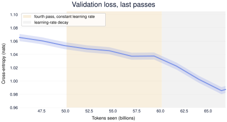

# Can a small encoder pretrained on Slovene alone beat multilingual encoders on Slovene tasks?

## Question

Slovene already has encoders: SloBERTa, trained on Slovene, and multilingual ones such as XLM-R and mmBERT, which share their capacity across hundreds of languages. Newer encoder designs, ModernBERT and DeBERTa-v3, have not been pretrained on Slovene. The project needs to know whether a new encoder under one billion parameters, pretrained on its own curated Slovene corpus, outscores the existing ones, because that encoder is the backbone of its information-extraction models. An answer names the architecture, the tokenizer and the pretraining budget. It also reports the margin over the strongest existing encoder on the Slovene task registry, measured under one fine-tuning protocol.

## What we now believe

- **ModernBERT-base trains stably on the curated Slovene corpus with its published recipe, and was still improving after four passes**: nothing in the run sends the recipe back before the baselines and the architecture comparison use it ([modernbert-pilot-slovenian:F1], [modernbert-pilot-slovenian:F4]).
- **Figure**: 
- **Caveat:** the pilot rests on one seed and on masked-token loss alone, which has no comparison model; it rules the recipe out or not, and says nothing yet about downstream quality ([modernbert-pilot-slovenian:F1]).

## Threads

- **Pretraining recipe on Slovene**: does the upstream ModernBERT recipe train stably on the curated Slovene corpus, and how far does it get? — [modernbert-pilot-slovenian:Q1], [modernbert-pilot-slovenian:Q2]
  - **Standing**: answered, [modernbert-pilot-slovenian:F1], [modernbert-pilot-slovenian:F4]

## Open

- how well the existing Slovene and multilingual encoders do under one protocol, which sets the bar — answered by encoder-baselines-slovenian
- which architecture to pretrain, compared at proxy scale before any full run — answered by encoder-architecture-slovenian
- which tokenizer to pretrain with — answered by tokenizer-downstream-slovenian, in the Slovene tokenizer choice programme
- whether the full-scale model beats the bar — answered by encoder-pretraining-slovenian
- why the exported pilot model scores a lower loss than its training log — not yet planned: a scoring difference is the likely cause
- how far pretraining loss varies between seeds — not yet planned
