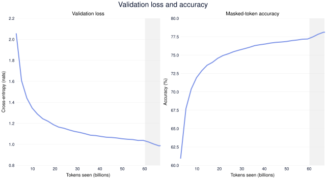

# How low do masked-token loss and error fall when ModernBERT-base is pretrained on the curated Slovene corpus, and does it train stably?

## TL;DR

<!-- generated by labflow_report derive from Findings and Verdict: edit those and rerun derive -->

- **F1 — The model was still improving at the end of the fourth pass.** Validation loss fell from 1.053 to 1.038 over the fourth pass at constant learning rate, more than the noise of the validation set.
- **F4 — Training stayed stable after warmup.** No 500-batch window held a gradient spike, and the mean gradient norm stayed between 0.25 and 0.29 after warmup.

## Hypothesis

- **Question**: When ModernBERT-base is pretrained from scratch on the curated Slovene corpus with the official recipe, what validation loss and masked-token accuracy does it reach, and does training stay stable?
- **Decision it informs**: Whether to fix the recipe or the training setup, ModernSloBERT on two RTX PRO 6000 GPUs, before the encoder baselines and the architecture comparison use this checkpoint. The pilot can only rule the recipe out: an unstable run or a model that stopped improving early sends it back, while a clean run shows no fitness, since masked-token loss has no comparison model here.
- **Disclosure**: earlier runs: the run this record reports finished on 2026-11-25 in the ModernSloBERT repository, before this record was written. Its validation loss (0.987) and masked-token accuracy (78.1%) were seen before the clauses below were set, so the clauses only report and set no bar.
- **Statement**: Pretrained for four passes over the corpus, ModernBERT-base keeps lowering its validation loss through the fourth pass at constant learning rate, by more than the noise of the validation set, with no loss spike or gradient blow-up.
- **Rationale**:
  - **The recipe is published and was tuned at this model size.** ModernBERT's authors trained the base model with this optimizer, learning rate and batch size on English text, so the recipe should carry over with the data and tokenizer swapped.
  - **Four passes over the data still help.** Muennighoff et al. found that up to about four passes over the same data is almost as useful as new data, which sets the training length [@muennighoff2023scaling].
  - **The data can carry the measurement.** The training split holds 16.7 billion tokens and the validation split is scored every 500 batches, so the curve has about 30 points.
- **Predictions**: Each clause reads the single training run on the validation split of the curated corpus, with 15% of tokens masked.
  - **Q1 · measured — How far masked-token loss and accuracy fall over four passes**: read on the learning-curve figure of validation loss and masked-token accuracy against tokens seen; reported as the final values after the learning-rate decay, and as the change in validation loss over the fourth pass at constant learning rate (50.1 to 60.1 billion tokens) beside a 95% bootstrap interval of the final loss over validation documents — a gain larger than that interval argues for a longer run in the full-scale pretraining experiment.
  - **Q2 · diagnostic · measured — Whether training stays stable**: read on the training-dynamics figure of learning rate, training loss and gradient norm against tokens seen, with the per-bin maxima beside the per-bin means; reported as the gradient norm's range from 12 billion tokens to the start of the decay at 60.1 billion, and the count of spikes over the whole run, a spike being a 10-batch gradient-norm reading above three times its 500-batch mean or a batch's training loss more than 0.5 above its 500-batch mean — a spike or a growing norm would mean the recipe needs changes before the comparison runs.
  - **Read beside the clauses, not as clauses**: throughput in tokens per second, GPU use and wall-clock hours; the masked-token loss of the exported HuggingFace model against the last training evaluation.
- **Outcome**: open

## Design

- **Inputs**: The curated Slovene pretraining corpus slm4ie-pretrain, tokenized with the 32,000-token byte-level BPE tokenizer of the tokenizer sweep, described in `## Datasets`.
- **Method / factors**: One pretraining run, then an export check.
  - Pretrain ModernBERT-base from scratch with the upstream recipe, Slovene data and tokenizer swapped in ([M1])
  - Score the validation split every 500 batches at 15% masking ([M2])
  - Bootstrap the final checkpoint's validation loss over sequences for a noise band ([M3])
  - Count loss and gradient spikes per 500 batches ([M4])
  - Factors: none varied; architecture, optimizer, learning rate and batch size are fixed at the upstream values ([D2])
- **Metrics**: primary masked-token cross-entropy; secondary masked-token accuracy, gradient norm — each defined in `experiments/GLOSSARY.md`
- **Protocol**: one tracked run, the finished ModernSloBERT run 0e0b096c reported as the record's run ([D1]); one seed, no repeats. The MLflow run lives in the local store of the training host; the imported tables are checked against it, and the ModernSloBERT commit that exported them is recorded.
- **Compute**: 88 GPU-hours, done — local GPU: two NVIDIA RTX PRO 6000 Blackwell (96 GB) for 44 hours on host e3black.
- **People**: none — no annotation or review.
- **Data access**: none — the corpus and tokenizer are the project's own.
- **External dependency**: none — the run calls no hosted model or service.

## Datasets

- **slm4ie-pretrain** (own; none labels): one item is a 1,024-token sequence cut from one document of the curated Slovene corpus after sentence-level deduplication, tokenized with the 32,000-token BPE tokenizer. 0.1% of documents are held out by document as the validation split (seed 13); the counts come from the conversion manifest in `configs/corpus-manifest.json`. [size and grouping](tables/dataset-slm4ie-pretrain-summary.csv) [fields](tables/dataset-slm4ie-pretrain-fields.csv) [tokens by source](tables/dataset-slm4ie-pretrain-statistics.csv)

## Methods

### M1 — Pretrain ModernBERT-base on the training split

- **Input**: the training split of slm4ie-pretrain, one 1,024-token sequence per item, packed into batches of 4,608 sequences.
- **Output**: a checkpoint every 500 batches and per-batch training loss, learning rate and gradient norm in the MLflow run 0e0b096c, on the training host.
- **How**: ModernSloBERT's `scripts/train.py` launched upstream ModernBERT's training code with the resolved config `configs/pretrain-modernbert-base.yaml`, on two GPUs; the training code lives in ModernSloBERT. 30% of tokens are masked per batch; the learning rate follows [D3]. The settings below are tabled from that config in `tables/training-value-by-setting.csv`.
- **Code**: `analysis.py::training_settings`
- **Settings**: `max_duration` (training length, 66,836,000,000 tokens), `optimizer.lr` (peak learning rate, 8e-4), `global_train_batch_size` (sequences per batch, 4,608), `mlm_probability` (training masking rate, 0.3)

### M2 — Score the validation split every 500 batches

- **Input**: the validation split, 32,237 sequences, and the model at each 500th batch of [M1].
- **Output**: one row per evaluation, validation loss and masked-token accuracy, in `tables/run-eval.csv`.
- **How**: 15% of tokens are masked and the loss is the mean cross-entropy over masked tokens. ModernSloBERT's `scripts/report_training.py` at commit 005ca9b exported the rows from the run's MLflow store; all 30 match the run's console log to four decimals.
- **Code**: `analysis.py::read_rows`
- **Settings**: `eval_interval` (batches between evaluations, 500), `eval_loader.dataset.mlm_probability` (evaluation masking rate, 0.15)

### M3 — Bootstrap the final validation loss over samples

- **Input**: the HuggingFace export of the final checkpoint and every validation sequence.
- **Output**: each sequence's masked-token count and summed loss in `tables/validation-sample-loss.csv`, and the mean loss with its 95% interval in `tables/bootstrap-final-loss.csv`.
- **How**:
  1. Mask 15% of each sequence's tokens with a fixed seed and sum the cross-entropy over masked positions.
  2. Draw 1,000 resamples of the sequences with replacement; each resample's loss is its summed loss over its summed masked tokens.
  3. Report the 2.5th and 97.5th percentiles as the interval. Each sequence keeps its one mask draw, so the interval covers which sequences and which masks were drawn; it resamples the 32,237 sequences, not the 22,904 documents they come from, so it may be too narrow.
- **Code**:
  - step 1: `bootstrap_loss.py::score_samples`
  - step 2: `bootstrap_loss.py::bootstrap`

### M4 — Count training spikes per 500 batches

- **Input**: `tables/run-train.csv`, one row per 500 batches with the mean and maximum training loss and gradient norm.
- **Output**: one row per bin in `tables/spike-count-by-bin.csv`, flagging a gradient spike and a loss spike.
- **How**: a bin holds a gradient spike when its largest 10-batch gradient-norm reading exceeds three times its mean, and a loss spike when its largest batch loss exceeds its mean by more than 0.5.
- **Code**: `analysis.py::spike_rows`

## Decisions

### D1 — Report the finished run instead of rerunning it

- **Decision**: The record reports the ModernSloBERT run that finished on 2026-11-25 as its one run. No rerun is made.
- **Why**: A rerun costs another 88 GPU-hours and the same recipe, data and seed would repeat the same numbers. The clauses only measure, so seeing the result first sets no bar after the fact; the Disclosure row says what was seen.
- **Alternatives**:
  - A pre-registered rerun from a clean commit: the labflow default for a measured record, rejected for its cost.
- **History**:
  - 2026-11-26 (after runs) Report the finished run, disclosed in the Hypothesis.

### D2 — Keep the upstream ModernBERT-base recipe unchanged

- **Decision**: The architecture, optimizer, peak learning rate 8e-4, batch size of 4,608 sequences and 30% training masking are ModernBERT's own. Only the vocabulary (32,000), the warmup (2 billion tokens) and the training length (66.8 billion tokens, four passes) change.
- **Why**: The recipe was tuned at this model size; changing it would confound the pilot with a tuning question.
- **History**:
  - 2026-11-23 (before runs) Upstream recipe with data, tokenizer and length swapped.

### D3 — Decay the learning rate to zero over the last tenth

- **Decision**: The learning rate warms up over 2 billion tokens, holds at its peak, and falls linearly to zero over the last 6.7 billion tokens.
- **Why**: Upstream decays in a separate later phase. A single run needs its own decay to give a finished model, and a constant phase keeps every earlier checkpoint usable as a starting point for a longer run.
- **History**:
  - 2026-11-23 (before runs) Warmup, constant, then decay over the last 10%.

## Findings

### F1 — The model was still improving at the end of the fourth pass · key

- **Summary**: Validation loss fell from 1.053 to 1.038 over the fourth pass at constant learning rate, more than the noise of the validation set.
- **Key number**: 0.987 — validation loss after the learning-rate decay, at 15% masking
- **Runs**: 0e0b096cf1524a028905c8c2d1085f45
- **Result**: 
- **Reading**:
  - **Loss kept falling at constant learning rate, by less each pass.** Over each 9.4 billion tokens before the decay, loss fell by 0.038, then 0.022, then 0.016; the last step at constant learning rate was flat. The final model reaches a masked-token accuracy of 78.1%.
  - **[Q1] is answered: the fourth pass still lowered the loss beyond the noise band.** The fourth-pass drop of 0.016 exceeds the full width of the 95% bootstrap interval of the final loss, 0.011 ([M3]). That interval resamples sequences rather than documents, so the true noise may be somewhat larger.
  - **A second seed could overturn it.** A rerun whose fourth-pass change falls inside its own interval, or a document-level bootstrap twice as wide, would leave the gain unproven.
- **Implication**: The full-scale pretraining experiment can expect gains from more than four passes or more data, though each extra pass returns less than the one before.
- **History**:
  - 2026-11-26 First result, run 0e0b096c, from tables exported at ModernSloBERT 005ca9b.

### F2 — The learning-rate decay gave three times the fourth pass's gain · supporting F1

- **Summary**: Lowering the learning rate to zero over the last 6.7 billion tokens took validation loss from 1.038 to 0.987.
- **Runs**: 0e0b096cf1524a028905c8c2d1085f45
- **Result**: [validation loss and accuracy by tokens seen](tables/pilot-validation-loss-by-tokens.csv)
- **Reading**:
  - **The decay lowered the loss faster than any stretch at constant rate.** In its 6.7 billion tokens the loss fell 0.051 and accuracy rose from 77.2% to 78.1%.
  - **It qualifies the still-improving model ([F1]).** Part of the final level comes from the decay, not from more data, so a comparison between models must give each run its own decay ([D3]).
  - **A run decayed earlier could overturn it.** If decaying at three passes reached the same loss, the fourth pass would add little.
- **History**:
  - 2026-11-26 First result, run 0e0b096c.

### F3 — The exported model scores a lower loss than the training log · minor

- **Summary**: The HuggingFace export scores 0.975 on the whole validation split, against 0.987 in the training log, outside the bootstrap interval.
- **Runs**: 0e0b096cf1524a028905c8c2d1085f45
- **Result**: [final loss with its bootstrap interval](tables/bootstrap-final-loss.csv)
- **Reading**: The two evaluations mask and score tokens differently (numeric precision, which tokens may be masked), so the gap is most likely in the scoring, not the model, and the export's loss is never compared with logged values.
- **History**:
  - 2026-11-26 First result, the bootstrap over the export of run 0e0b096c.

### F4 — Training stayed stable after warmup · key

- **Summary**: No 500-batch window held a gradient spike, and the mean gradient norm stayed between 0.25 and 0.29 after warmup.
- **Key number**: 0 — gradient spikes over 14,591 batches
- **Runs**: 0e0b096cf1524a028905c8c2d1085f45
- **Result**: 
- **Reading**:
  - **The largest gradient reading stayed far under the spike threshold.** After 5 billion tokens no reading exceeded 1.35 times its window's mean, against a threshold of 3, though the ratio crept up before the decay. The loss rule flags two windows, the first 1,000 batches, where the loss falls from 10.5, a descent rather than a spike; after that no batch exceeded its window's mean by more than 0.11.
  - **[Q2] is answered: the run shows no instability.** The clause is diagnostic, so it only rules out a broken recipe and decides nothing alone. The run had one launch and no resume, so no step was averaged across a restart.
  - **Per-batch gradient readings could overturn it.** The norm was logged every 10 batches, so a spike between two readings would be missed.
- **Implication**: The recipe needs no change before the encoder baselines and the architecture comparison use it.
- **History**:
  - 2026-11-26 First result, run 0e0b096c.

## Verdict

<Written once, at conclusion, by `labflow:report` after user approval.>

## Reproduce

<Written at conclusion by `labflow:report`.>
