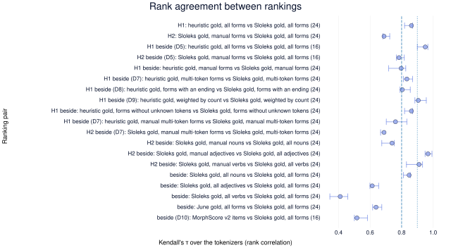

# Which tokenizer should a small Slovene language model use?

## Question

Slovene is morphologically rich: a noun inflects for six cases in three numbers, and the ending carries case, number and gender. A tokenizer that cuts words into pieces by frequency alone may split stems and endings at arbitrary points. The question is whether a small Slovene model needs a tokenizer changed for this, or whether an existing algorithm is already good enough or best. The project needs the answer before it pretrains its models, since the tokenizer is fixed for the life of a model. An answer names the algorithm and the vocabulary size, rests on metrics shown to measure what they claim, and is checked against the scores of small models trained with the candidates.

## What we now believe

- **The morphological gold does not decide which tokenizer looks best, but the set of scored forms does.** The stem-ending split of the Sloleks authors and the project's corrected heuristic rank the 24 tokenizers alike [morph-gold-slovenian:F1]. Scoring only the manually checked forms reorders them, because the manual forms hold fewer nouns and the word classes rank the tokenizers apart [morph-gold-slovenian:F2]. Every morph score is therefore reported on the manual forms first, and per word class beside the pooled score.
- **Figure**: 
- **Unigram cuts closest to the Sloleks morphemes and is the one algorithm still gaining at 128k, while compression improves for every algorithm.** Compression and Morph-Edit-Distance have not levelled off for any of the six algorithms by 128k, and morpheme-boundary F1 still rises there for Unigram alone [morph-gold-slovenian:F3].

## Threads

- **Trust in the morphological gold**: whether the gold that defines a correct morpheme cut changes which tokenizer looks best — [morph-gold-slovenian:H1], [morph-gold-slovenian:H2]
- **Vocabulary size**: which metrics still improve as the vocabulary grows, and where each levels off for Slovene — [morph-gold-slovenian:Q1]

## Open

- whether metrics beyond boundary F1 separate tokenizers that it ranks alike — answered by morph-metrics-slovenian
- whether a band from the bootstrap intervals reads the levelling of a metric better than the quarter rule, which turns changes narrower than the interval into falls or gains — answered by morph-metrics-slovenian
- whether the automatic noun rows of Sloleks 3.2 carry errors that move a ranking, since nouns are the class where the manual and the all-forms rankings agree least — not yet planned: an audit of the lexicon
- which metrics are redundant — answered by metric-redundancy-slovenian
- whether the morphological algorithms improve once trained on a correct table — answered by morph-table-slovenian
- whether a changed BPE training rule helps Slovene — answered by bpe-pruning-slovenian and stem-protection-slovenian
- whether any tokenizer metric predicts model quality, starting on the 24 tokenizers of the gold experiment, with the tokenizers of bpe-pruning-slovenian and stem-protection-slovenian joining as later arms — answered by tokenizer-downstream-slovenian
- whether freezing the embeddings of some tokens, such as rare tokens or tokens with a single meaning, speeds up pretraining without losing model quality — not yet planned: a follow-up on the models of tokenizer-downstream-slovenian
