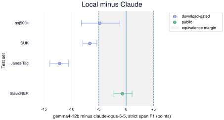

# Can a model under one billion parameters extract Slovene information within reach of frontier LLMs?

## Question

Frontier LLMs such as Claude, GPT and Gemini extract entities from text in many languages without task-specific training, but they are large, paid per call and cannot run on a local GPU. The project commits to models under one billion parameters that fit in 8 GB of GPU memory and come within 5–10% of those LLMs on Slovene information extraction (KPIs 5–7). GLiNER is the candidate design: an encoder scores each text span against label names, so new labels need no retraining. The question is whether such a model, built on the right backbone and fine-tuned on medical and scientific examples, reaches that margin. An answer gives each model's score next to the best LLM's on the same test sets, with its parameters, peak memory, and cost per document.

## What we now believe

- **The best open LLM on one 16 GB GPU comes within the margin of Claude on one Slovene NER test set of four**: Gemma 4 12B trails Claude Opus by 5 to 12 points of strict span F1 on the download-gated sets, most on social-media text ([ie-benchmark-slovenian:F1]). Its deficit is largest on rare labels ([ie-benchmark-slovenian:F3]). So silver labels for the later experiments need Claude.
- **Figure**: 
- **Zero-shot reference scores now exist for Slovene NER on four test sets**: the strongest model scores from 78 strict span F1 on ssj500k to 94 on SUK, and later models are scored on the same sets and protocol ([ie-benchmark-slovenian:F4]).
- **Caveat:** every score is zero-shot NER only; question answering, classification and typed-decision models such as Jev are not yet measured ([ie-benchmark-slovenian:F4]).

## Threads

- **Reference scores**: where Claude and open LLMs on one local GPU stand on Slovene extraction, and whether a local model can label the silver data — [ie-benchmark-slovenian:C1], [ie-benchmark-slovenian:Q1]
  - **Standing**: in part, [ie-benchmark-slovenian:F1], [ie-benchmark-slovenian:F4]

## Open

- where Jev, a typed-decision model, stands on the same Slovene NER test sets — answered by jev-ner-slovenian
- where frontier and open LLMs stand on Slovene question answering and classification — not yet planned: needs a SentiNews extractor and labelled SuperGLUE-SL test files
- which backbone a Slovene GLiNER model should use — answered by gliner-backbones-slovenian
- whether domain fine-tuning closes the gap on medical and scientific text — answered by domain-finetune-slovenian
