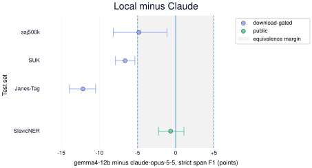

# How close an open LLM on one local GPU comes to Claude on Slovene information extraction

## TL;DR

<!-- generated by labflow_report derive from Findings and Verdict: edit those and rerun derive -->

- **Hypothesis**: partial (concluded 2026-11-17) — the best open LLM on one 16 GB GPU comes within the margin of Claude on one Slovene NER test set of four.
- **F1 — Claude leads the best local model beyond the margin on two of four test sets.** Claude Opus leads Gemma 4 12B by more than 5 points of strict span F1 on SUK and Janes-Tag, not on SlavicNER.
- **F4 — The reference scores stand on four Slovene test sets for seven local and three Claude models.** The highest zero-shot strict span F1 any model reaches ranges from 78 on ssj500k to 94 on SUK, the reference the project's small models must approach.
- **Next**: Score Jev, a typed-decision model that returns a probability per allowed answer, on the same four test sets, with candidate spans posed as choice questions — planned as jev-ner-slovenian

## Hypothesis

- **Question**: How close does the best open LLM that runs on one 16 GB GPU come to the best Claude model when both extract information from Slovene text zero-shot, under one fixed protocol?
- **Decision it informs**: whether the silver-label experiments (silver-ner-slovenian, medical-ie-slovenian, science-ie-slovenian) annotate their Slovene documents with a local open model or with Claude.
- **Statement**: on Slovene named-entity recognition, the best Claude model leads the best local open LLM by more than 5 points of strict span F1, so silver annotation needs Claude.
- **Rationale**:
  - **The silver-label experiments need an annotator, and the two kinds cost differently.** KPI 2 asks for more than 10,000 medical examples, and the silver experiments label native documents with an LLM. A local model costs only GPU time and keeps the text on project hardware. Claude runs through a subscription whose rate limits bound how many documents a day it can label.
  - **No zero-shot LLM result for Slovene NER was found.** The ticket's draft expected a frontier lead of more than 10 F1 points on NER. That expectation comes from English work, where small open models trail frontier models most on span extraction. GaMS, trained further on Slovene, may narrow the gap for its size.
  - **The test sets avoid open web copies where they can.** Janes-Tag, ssj500k and SUK are distributed through the CLARIN.SI repository behind a download, which lowers the chance that a model saw them in training. SlavicNER has been public on GitHub since 2017, so a lead that appears only there hints at memorisation.
  - **The data can carry the comparison, by the counts on disk.** The SUK test split holds 733 documents with 18,548 gold spans and ssj500k holds 233 documents with 1,031. Janes-Tag adds about 1,500 short social-media texts, and SlavicNER about 250 news documents with about 10,000 mentions. The sentiment and SuperGLUE-SL entries cannot be scored yet, because SentiNews has no extractor and the SuperGLUE-SL test files carry no labels. They wait for a later round. Counts in [test-set sizes per task registry entry](tables/scoping-test-sets.csv).
- **Predictions**: every clause is read on the test splits of four NER entries, `ner/ssj500k`, `ner/suk`, `ner/janes_tag` and `ner/slavicner`, each model prompted zero-shot once per document ([D3], [D9]). The Claude arm and the local arm each send their best model, picked on the validation splits ([D1], [D7]). Intervals are 95% paired bootstraps over test documents ([D5]).
  - **C1 — The best local open LLM against the best Claude model on strict span F1**: read once per test set; better if the interval of local minus Claude lies above +5 points, worse if it lies below −5 points — equivalent inside the margin and undecided when it straddles; equivalent or better lets the silver experiments annotate locally ([D2]; measured by [M3]).
  - **Q1 · diagnostic · measured — Where each model stands on each test set**: read on the table of strict span F1 per model and test set and on the figure of F1 against peak GPU memory; reported as strict micro F1 with its 95% interval — it is the reference the KPI 7 margins are measured against ([D1]; measured by [M3]).
  - **Verdict rule**: adopted, the local annotator, when C1 is equivalent or better on all four test sets. Inconclusive when no set reads worse but at least one is undecided. Rejected when at least one set reads worse and none reads equivalent or better. Partial when some sets read worse and others equivalent or better, the genre reading: the local model annotates only the genres where it holds.
  - **Read beside the clauses, not as clauses**: partial-overlap span F1, macro F1 over labels and F1 per label; the miss rate per model and set ([D6]); tokens in and out; the list-price cost per 1,000 documents for Claude ([D8]); peak GPU memory and documents per second for the local models; strict F1 per SUK subcorpus; the gap on SlavicNER beside the gap on the download-gated sets.
- **Outcome**: partial

## Rounds

### R1 — NER on four test sets, Claude against local open models

- **Opened**: 2026-11-06
- **Tests**: whether a local open model is close enough to Claude on Slovene NER to annotate the silver sets, which three later experiments wait on.
- **Clauses**: C1, Q1
- **Budget**: three Claude models and nine local models, each over the validation and test splits of four entries, about 90 tracked runs. The round ends early when no local model passes the miss-rate gate ([D6]).
- **Pre-registered at**: ac2e506
- **Closed**: 2026-11-17 conclude — C1 read on all four test sets and Q1 answered; the local model trails beyond the margin on two sets, citing [F1] and [F4]

## Design

- **Inputs**: the validation and test splits of four NER task registry entries: `ner/ssj500k` and `ner/suk` as built, and `ner/janes_tag` and `ner/slavicner`, added for this experiment as held-out entries that no training run may read, described in `## Datasets` ([share of each label among the gold spans of each test split: persons are 74% of Janes-Tag and 57% of SlavicNER, organisations lead only in SUK at 42%, and SlavicNER has products (PRO) and events (EVT) in place of the miscellaneous class and names derived from persons (DERIV-PER)](figures/dataset-test-sets-spans-by-label.svg)).
- **Method / factors**: one pass from a test document to a score per model and test set.
  - Write a plain-language description for every label of every label set ([D4], [M1]).
  - Prompt every model once per sentence window of a document with the same template and JSON schema, one try per window, logged as one run per model and split ([D3], [M2], [M5]).
  - Align the returned mentions to character spans, score strict, relaxed and partial-overlap span F1, and bootstrap over documents ([D5], [M3]).
  - Pick each arm's best model on the validation splits and compare the two on the test splits ([D1], [M4]).
  - Factors: the arm (Claude, local open model) is the factor under test. Each arm's best is picked from its models ([D7]). The Claude arm holds Opus, Sonnet and Haiku 5.5. The local arm holds Qwen3.5, Gemma 4, Gemma 3, Llama and GaMS, most at two sizes, that fit on the GPU. The prompt, the schema, the decoding and the label descriptions are fixed for every model.
- **Metrics**: primary strict span F1; secondary relaxed and partial-overlap span F1, macro F1 and miss rate — each defined in `experiments/GLOSSARY.md`
- **Protocol**: one tracked MLflow run per model, entry and split under `slm4ie/validation/ie-benchmark-slovenian`, tagged `language=sl`. Each run logs every raw answer, so `analysis.py` rescores without calling a model again. Each model runs once: greedy decoding with a fixed seed where the backend allows; Claude's CLI takes neither, so its run-to-run noise is unmeasured ([D3]).
- **Compute**: local GPU — one GeForce 4080 GPU with 16 GB serves the open models through the local vllm-service, which also gives each model's peak memory ([D7]). All but Qwen3.5 4B and Llama 3.2 3B run at fp8 or as 4-bit checkpoints.
- **People**: about 1 hour — the user reviews the label descriptions before the first tracked run.
- **Data access**: open — Janes-Tag 3.0 from CLARIN.SI under CC BY-SA 4.0; SlavicNER from its GitHub release, for research use.
- **External dependency**: Claude subscription — the Claude models run through the user's subscription in Claude Code's headless mode, whose rate limits bound throughput; the open models need the local vllm-service.

## Datasets

- **ssj500k** (benchmark; gold labels): one item is one NER-annotated document of ssj500k 2.3 (CLARIN.SI 11356/1434), a sample of FidaPLUS, the balanced reference corpus of written Slovene, with its named entities as character spans. It is the `ner/ssj500k` task registry entry, kept to the documents annotated for entities and split by a hash of the document id into train, validation and test; this experiment reads only the 91 validation and 88 test documents ([D11]). [Documents, spans and document lengths per split](tables/dataset-ssj500k-summary.csv) [Fields](tables/dataset-ssj500k-fields.csv) [Spans per split and label](tables/dataset-ssj500k-statistics.csv)
- **SUK** (benchmark; gold labels): one item is one document, or one ElexisWSD sentence, of SUK 1.1 (CLARIN.SI 11356/1959), the Slovene training corpus, with its named entities as character spans. It is the held-out `ner/suk` entry without the ssj500k documents it contains: SentiCoref news articles with coreference and entity labels, and ElexisWSD sentences built for word-sense disambiguation, each counted as a document of its own; its Ambiga part carries no entity labels, so it adds no documents; split in half by a hash of the document id ([D11]). [Documents, spans and document lengths per split](tables/dataset-suk-summary.csv) [Fields](tables/dataset-suk-fields.csv) [Spans per split and label](tables/dataset-suk-statistics.csv)
- **Janes-Tag** (benchmark; gold labels): one item is one tweet, forum post, blog comment or news comment of Janes-Tag 3.0 (CLARIN.SI 11356/1732), with its named entities as character spans; Twitter handles are tagged as persons. Only the janes-tag part carries entities, so the newer Janes-RSDO tweets are left out. It is the held-out `ner/janes_tag` entry, split in half by a hash of the document id ([D11]). [Documents, spans and document lengths per split](tables/dataset-janes-tag-summary.csv) [Fields](tables/dataset-janes-tag-fields.csv) [Spans per split and label](tables/dataset-janes-tag-statistics.csv)
- **SlavicNER** (benchmark; gold labels): one item is one Slovene news article of SlavicNER, the BSNLP 2017–2023 shared-task corpus, with its person, organisation, location, event and product mentions as character spans. It is read from the GitHub repository at commit 2c72947 (2024-05-18) as the held-out `ner/slavicner` entry, split by the single-topic-out protocol of its corpus paper (Piskorski, Marcińczuk and Yangarber, 2024), with 2020 United States presidential election as the test topic, after repeated articles and one municipality table are dropped ([D10], [D11], [D12]). [Documents, spans and document lengths per split](tables/dataset-slavicner-summary.csv) [Fields](tables/dataset-slavicner-fields.csv) [Spans per split and label](tables/dataset-slavicner-statistics.csv)

## Methods

### M1 — Describe every label in plain words from its annotation guidelines

- **Input**: the label sets of the four NER task registry entries in `configs/data/tasks.yaml`: PER, LOC, ORG, MISC and DERIV-PER for ssj500k, SUK and Janes-Tag; PER, ORG, LOC, EVT and PRO for SlavicNER.
- **Output**: one description per label, grouped into two label sets, which [M2] puts into the prompt.
- **How**:
  1. Write one scope description per label from its set's annotation guidelines. ssj500k, SUK and Janes-Tag share the Slovene NER guidelines; SlavicNER uses the BSNLP guidelines. Where a guideline leaves a case open, the description follows the validation gold.
  2. Give every label two example lists. `unseen` names match no gold mention of any test split. `common` names are frequent names that occur among the test mentions; round 1 ran only the `unseen` list, and `common`, kept for a later measure of how much naming test mentions lifts scores, would match 17 of 1,031 ssj500k, 717 of 15,591 SUK, 24 of 2,272 Janes-Tag and 534 of 6,823 SlavicNER test mentions, counts taken once while writing the lists and not recomputed.
  3. Append the chosen list to each description as `Examples: <name>, <name>.`
- **Code**: `slm4ie/evaluation/prompts.py::load_label_descriptions`
- **Settings**: `label_sets` (each label set's task entries, and per label its description and both example lists), in `configs/evaluation/ner-labels.yaml`; `DEFAULT_EXAMPLES` (the example list a run uses unless told otherwise, unseen), in `slm4ie/evaluation/prompts.py`

### M2 — Prompt every model once per sentence window and parse its JSON answer

- **Input**: one document of a task file, its id and text, and its entry's label descriptions from [M1].
- **Output**: for every window of the document, the returned mentions as `{text, label}` in answer order, or a miss, with the window's start offset; the mentions go to [M3], and the offset maps their spans back to the document.
- **How**:
  1. Split the text into sentences. A line break ends one, and so does a run of `.`, `!`, `?` or `…` followed by whitespace and a capital letter or an opening quote, unless the period follows an abbreviation, an initial or an ordinal.
  2. Pack consecutive sentences into windows of at most `MAX_WINDOW_CHARS` characters; a longer sentence is a window of its own. Each window is an exact slice of the text.
  3. Send each window as two chat turns: `SYSTEM_PROMPT`, then `USER_PROMPT` with the label descriptions, the rules (copy each mention exactly, list every occurrence in reading order, name only, an empty list allowed), the JSON shape and the window text.
  4. Decode against the answer schema: an object holding a `mentions` list of `{text, label}`, the text non-empty and the label one of the entry's labels, with no other keys. vllm and transformers decode greedily with seed `DEFAULT_SEED` and the schema enforced: vllm with thinking off, transformers through xgrammar, 4- or 8-bit when a model would not fit. Claude headless gets the schema as `--json-schema` with no retry, at the CLI's own sampling, which takes no seed. Output stops at `MAX_NEW_TOKENS` where the backend takes a cap; a `<think>` block is stripped.
  5. Parse the answer after stripping one markdown fence. An answer off the schema is a missed window and gives no mentions; the miss rate is the share of missed windows.
- **Code**:
  - step 1: `slm4ie/evaluation/prompts.py::_sentence_bounds`
  - step 2: `slm4ie/evaluation/prompts.py::sentence_windows`
  - step 3: `slm4ie/evaluation/prompts.py::build_messages`
  - step 4: `slm4ie/evaluation/backends/base.py::get_backend`
  - step 5: `slm4ie/evaluation/prompts.py::parse_answer`
- **Settings**: `MAX_WINDOW_CHARS` (longest window in characters, 2,000), `SYSTEM_PROMPT` (the system turn), `USER_PROMPT` (the user turn's template), in `slm4ie/evaluation/prompts.py`; `MAX_NEW_TOKENS` (longest answer in tokens, 2,048) and `DEFAULT_SEED` (the seed every local model decodes with, 0), in `slm4ie/evaluation/backends/base.py`

### M3 — Align returned mentions to spans, score them and bootstrap F1 over documents

- **Input**: for every document of one test split, the gold spans from the task file and one model's returned mentions. A gold span is a character range with a label, `{start, end, label}`, end exclusive; a returned mention is its text and label, `{text, label}`, in answer order.
- **Output**: strict, relaxed and partial-overlap counts per document, the pooled micro F1, macro F1 and a 95% interval for each model and test split. For two models on the same split, their F1 difference with its paired interval; these feed [M4] and `analysis.py`.
- **How**:
  1. Align each mention to the first free occurrence of its exact text after the previous match's end, else from the text's start; free means overlapping no taken span. Otherwise it stays unaligned, matching nothing.
  2. A (start, end, label) triple repeated in one document counts once.
  3. Strict: a predicted triple is a true positive when the gold spans hold it too.
  4. Relaxed: a predicted span pairs with a same-label gold span it contains, $s_p \le s_g$ and $e_g \le e_p$, with $s$ the start and $e$ the end of the predicted ($p$) and gold ($g$) span.
  5. Partial overlap: a predicted span pairs with a same-label gold span sharing a character, $s_p < e_g$ and $s_g < e_p$.
  6. Under steps 4 and 5 each span pairs at most once; the true positives are the largest pairing, by Kuhn's augmenting-path algorithm.
  7. Pool the counts over the split into $F_1 = 2\,TP / (P + G)$, with $TP$ the true positives, $P$ the predicted and $G$ the gold spans; $F_1 = 0$ when $P + G = 0$. Macro F1 averages strict F1 over labels, each pooled over documents.
  8. Redraw the documents with replacement `n_resamples` times; the interval is the central `confidence` share of the redrawn F1.
  9. For two models, each draw scores both on the same documents and keeps their F1 difference; mismatched document ids stop the step.
- **Code**:
  - step 1: `slm4ie/evaluation/scoring.py::align_mentions`
  - step 2: `slm4ie/evaluation/scoring.py::score_document`
  - step 3: `slm4ie/evaluation/scoring.py::score_document`
  - step 4: `slm4ie/evaluation/scoring.py::_contains`
  - step 5: `slm4ie/evaluation/scoring.py::_overlaps`
  - step 6: `slm4ie/evaluation/scoring.py::_max_matching`
  - step 7: `slm4ie/evaluation/scoring.py::macro_f1`
  - step 8: `slm4ie/evaluation/scoring.py::f1_interval`
  - step 9: `slm4ie/evaluation/scoring.py::paired_difference_interval`
- **Settings**: `n_resamples` (redrawn test sets per interval, 10,000), `seed` (random generator seed, 0), `confidence` (share of draws the interval covers, 0.95), defaults in `slm4ie/evaluation/scoring.py`

### M4 — Pick each arm's best model on validation and read C1 on the test splits

- **Input**: the finished tracked runs of the MLflow experiment with the `unseen` example variant and no window budget, each with its answers file from [M5]; the model list mapping each run's backend and model to a model key and an arm.
- **Output**: the reference table of every model on every split, the picks table, the C1 table with one reading per test set and the verdict, and, from the memory runs, the parameter counts and the pooled test throughput, mean test strict F1 beside peak GPU memory, parameters and speed, each with its figure.
- **How**:
  1. Keep the newest run of each model, entry and split, and rescore it from its answers with [M5] step 4 and [M3].
  2. Admit a model when it has a validation run on all four entries and its miss rate is at most `MISS_RATE_CEILING` on each ([D6]).
  3. Pick each arm's admitted model with the highest strict F1 averaged over the four validation splits ([D1]).
  4. On each test set, take the paired bootstrap interval of local minus Claude strict F1 ([M3] step 9). Read it as better when its low end exceeds $+m$, worse when its high end falls below $-m$, equivalent when it lies within $[-m, +m]$, else undecided, with $m$ = `MARGIN` ([D2]).
  5. Apply the record's verdict rule to the four readings; a test set without both picked runs leaves the verdict incomplete.
  6. Take each local model's newest memory run ([M5]) and compute its peak GPU memory as weights + KV bytes per token × the longest window of its scored runs, input plus output tokens.
- **Code**:
  - step 1: `experiments/validation/ie-benchmark-slovenian/analysis.py::score_runs`
  - step 2: `experiments/validation/ie-benchmark-slovenian/analysis.py::pick_rows`
  - step 3: `experiments/validation/ie-benchmark-slovenian/analysis.py::pick_rows`
  - step 4: `experiments/validation/ie-benchmark-slovenian/analysis.py::read_clause`
  - step 5: `experiments/validation/ie-benchmark-slovenian/analysis.py::verdict`
  - step 6: `experiments/validation/ie-benchmark-slovenian/analysis.py::peak_memory_gib`
- **Settings**: `MARGIN` (equivalence margin in strict F1, 0.05), `MISS_RATE_CEILING` (highest validation miss rate a pick may have, 0.10), `CLAUSE_EXAMPLES` (example variant C1 reads, unseen), in `experiments/validation/ie-benchmark-slovenian/analysis.py`

### M5 — Run one model over one split, keep every answer and log its usage

- **Input**: one model (backend, model name, backend options), one split of a NER task registry entry, and the label example variant of [M1].
- **Output**: an answers file with one JSON line per window: document id, window index, start and end offset, answer text, error, fresh, cache-written and cache-read input tokens, output tokens, list-price cost and seconds. One MLflow run logs the [M3] scores, the miss rate, timeouts, unaligned mentions, token sums, cost and speed, plus peak GPU memory for a transformers run; `analysis.py` rescores from the answers file alone. A memory run logs one MLflow run per model, tagged `model_key`, with `weight_bytes` and `kv_bytes_per_token` and no files.
- **How**:
  1. Cut each document into windows ([M2]); under a window budget, keep whole documents until the window count reaches it.
  2. Keep windows the answers file already holds. Send the first new window once untimed and discard the reply, so model loading stays out of the timing; it is asked again in step 3 and scored.
  3. Ask each remaining window once, the first included ([M2]) and append its line at once. A Claude call past its timeout is kept as a missed window with error `timeout`.
  4. Parse each answer, align its mentions to the window text, add the window's start to reach document offsets, and score each answered document ([M3]).
  5. Miss rate is missed windows over windows. Speed is windows, documents and output tokens per second of summed call time. Cost sums the CLI's reported list price.
  6. A memory run starts the model on the vllm-service with one request and reads the container's startup log: the weights' GPU memory (`Model loading took`) and the KV-cache memory per token (`Available KV cache memory` over `GPU KV cache size`). It logs both; [M4] adds the KV cache of the model's longest window.
- **Code**:
  - step 1: `slm4ie/evaluation/run.py::_budget_windows`
  - step 2: `slm4ie/evaluation/run.py::answer_split`
  - step 3: `slm4ie/evaluation/run.py::_ask`
  - step 4: `slm4ie/evaluation/run.py::score_split`
  - step 5: `slm4ie/evaluation/run.py::split_metrics`
  - step 6: `slm4ie/evaluation/memory.py::measure_vllm_memory`
- **Settings**: `window_budget` (windows after which a run stops at the next document end; every window when unset), `examples` (label example variant, unseen), `resume` (continue an existing answers file, off), `force` (discard an existing answers file, off), `backend_options` (backend settings such as quantization, or fold_system for a template without a system turn; none), fields of `BenchmarkRun` in `slm4ie/evaluation/run.py`; `CALL_TIMEOUT_SECONDS` (longest Claude call, 600), in `slm4ie/evaluation/backends/claude.py`; `CONTAINER_NAME` (the vllm-service container of a served model, vllm-{model}), in `slm4ie/evaluation/memory.py`

## Decisions

### D1 — Pick each arm's best model on the validation splits, then compare on the test splits

- **Decision**: the best model of each arm is the one with the highest strict span F1 averaged over the four validation splits. C1 then compares the two picked models on the test splits only.
- **Why**: picking the highest of up to nine scores on the test split favours the model that sampling noise lifted most, which overstates the winner.
- **Alternatives**:
  - Best on test: simpler, but the picked score is biased upward.
  - Compare every local model with Claude: nine comparisons, with a correction that would widen every interval.
- **History**:
  - 2026-11-06 (before runs) picked on the mean validation F1 over four entries.

### D2 — Set the margin for local against Claude at 5 F1 points

- **Decision**: C1 reads a difference within ±5 points of strict span F1 as equivalent.
- **Why**: KPI 7 asks for models within 5–10% of frontier LLMs, and 5 points is about 6% of an F1 near 80. The planned silver-ner-slovenian will use the same 5 points between models trained on silver and on gold labels.
- **History**:
  - 2026-11-06 (before runs) 5 points, proposed for approval at the start gate.

### D3 — Give every model the same zero-shot prompt and JSON schema, and count an unparseable answer as empty

- **Decision**: every model gets one prompt template per task family, the label descriptions and a window of whole sentences up to about 2,000 characters, and one try at a JSON answer against one schema. Decoding is greedy with a fixed seed where the backend allows; Claude's CLI allows neither. An unparseable answer scores as no mentions for its window.
- **Why**: one protocol makes scores comparable across this and later experiments. Published Slovene NER scores come from sentence-level input (CLASSLA, SloBENCH, the SlavicNER baseline's 256-token sequences), and a window that fits every model's context keeps context length out of the comparison between the two arms. An annotator that cannot produce valid output is not usable, so the failure counts against it.
- **Alternatives**:
  - Retry until the answer parses: hides a failure an annotation pipeline would meet.
  - One prompt per whole document: fewer calls, but the longest documents overflow a 16 GB model's context.
- **History**:
  - 2026-11-06 (before runs) one zero-shot template, one schema, no retries.
  - 2026-11-06 (before runs; user) sentence windows of about 2,000 characters in place of whole documents, following published protocols.
  - 2026-11-06 (before runs; user) a fixed seed and greedy decoding per model where the backend allows, one try per window, the schema enforced by vllm and by xgrammar under transformers. Claude's CLI takes no seed or temperature, so its run-to-run noise is unmeasured in round 1; decoding ablations wait for a later round.
  - 2026-11-06 (before runs; user) GaMS 9B's chat template rejects a system turn, so its system text opens the first user turn, followed by a blank line, as Gemma 3's template folds it; every other model keeps its system turn.
  - 2026-11-17 (after runs) the Predictions' "once per document" means once per sentence window, as this decision sets; Claude's CLI ran with its default reasoning and no output cap, the local models with thinking off and a 2,048-token cap.

### D4 — Pass labels as plain-language descriptions and score each test set on its own labels

- **Decision**: each label (PER, LOC, ORG, MISC, DERIV-PER; SlavicNER's PER, ORG, LOC, EVT, PRO) reaches the model as a short description written from its annotation guidelines, ending with example names from one of two lists: `unseen` (no test mention) by default, `common` to measure how much naming test mentions lifts scores. No label set is mapped onto another.
- **Why**: the medical and scientific experiments bring new label sets, and the same prompt must serve them. SlavicNER's event and product labels test that now.
- **History**:
  - 2026-11-06 (before runs) one description per label, reviewed by the user.
  - 2026-11-06 (before runs; user) two example lists per label, `unseen` as default, `common` to measure how much naming test mentions lifts scores.

### D5 — Align returned mention strings to spans in reading order, and resample whole documents

- **Decision**: each returned mention is matched to the first free occurrence of its text (overlapping no matched span) after the previous match, else from the text's start. A mention with no free occurrence counts as a false positive. A document is the unit the bootstrap resamples, and both arms are resampled on the same documents.
- **Why**: LLMs copy text more reliably than they count character offsets. Spans in one document are not independent, so resampling documents keeps the interval honest. The paired draw removes the variance the arms share.
- **History**:
  - 2026-11-06 (before runs) reading-order alignment, paired document bootstrap.
  - 2026-11-06 (before runs; user) fall back to the start of the text: a perfect answer listed by label scored strict F1 0.21–0.80 without it and 0.99 with it.
  - 2026-11-17 (after runs) the 0.21–0.80 range is one value per entry, for the gold mentions themselves returned grouped by label rather than in reading order; with the fallback they score 0.99 to 1.0, the small loss where a repeated name aligns to another of its occurrences.

### D6 — Admit a model as its arm's best only if it parses on at least 90% of windows

- **Decision**: a model whose miss rate (the share of prompt windows with an unparseable answer) exceeds 10% on any validation split cannot be its arm's best. It is still scored and reported.
- **Why**: a model that fails the format often wins or loses on parsing, not on extraction, and could not run an annotation pipeline unattended.
- **History**:
  - 2026-11-06 (before runs) 10% floor per validation split.
  - 2026-11-06 (before runs; user) counted per window, the unit a model answers, so the floor means the same on short and long documents.

### D7 — Count as local only open models that run on one 16 GB GPU

- **Decision**: the local arm holds open-weight models served on the project's 16 GB GPU, through the vllm-service or HuggingFace transformers, quantised when a model would not fit otherwise.
- **Why**: the annotator must run on project hardware, and KPI 5 judges memory on an 8–16 GB GPU.
- **Alternatives**:
  - Open models through OpenRouter: no GPU limit, but no memory figure, and GaMS is not hosted there.
- **History**:
  - 2026-11-06 (before runs; user) local GPU only, vllm-service first, transformers for the rest.
  - 2026-11-06 (before runs; user) nine local models, the ones that fit the GPU: Qwen3.5 4B (bf16) and 9B, Gemma 4 E4B and 12B (Google's 4-bit QAT checkpoints), Gemma 3 12B, Llama 3.2 3B (bf16) and 3.1 8B, GaMS 9B and GaMS3 12B. The rest load in fp8 under vllm and in 8-bit bitsandbytes under the transformers memory check. Gemma 3 12B is GaMS3 12B's base model at the same precision, so the pair isolates GaMS's Slovene pretraining. Qwen3.5 27B and 35B-A3B, Gemma 4 31B and GaMS2 27B do not fit even at 4 bits; Gemma 4 26B takes 13.4 GiB at 4 bits, too little room left for the cache.
  - 2026-11-07 (before runs; user) peak memory read from the vllm-service, not a transformers check: weights and KV bytes per token from each container's startup log, plus the KV cache of the model's longest window. transformers 5.22 decompresses the 4-bit Gemma 4 checkpoints to bf16 (14.8 GiB for E4B), and its 8-bit bitsandbytes loads differ from the fp8 the benchmark serves. Gemma 3 12B and GaMS3 12B run in vllm's eager mode with a 4,096-token context to fit.
  - 2026-11-09 (before runs; user) Llama 3.2 3B runs ssj500k only, decided mid-run before any finding: it repeats one mention until the 2,048-token cap in 74 of 159 validation windows (miss rate 47%, above the D6 ceiling), about 13 s per window, so its other six runs would cost a day of GPU time without a chance of the pick.
  - 2026-11-10 (before runs; user) GaMS 9B runs ssj500k and SUK validation only, decided mid-run before any finding: like Llama 3.2 3B and 3.1 8B it repeats one mention until the token cap (36–41% of ssj500k windows, above the D6 ceiling), about 27 s per window. GaMS3 12B, the newest GaMS on the Gemma 3 architecture, carries the Slovene-pretraining comparison with Gemma 3 12B.
  - 2026-11-11 (before runs; user) GaMS3 12B skips Janes-Tag and SlavicNER validation, decided mid-run before any finding: it repeats one mention until the token cap in 9–16% of windows at 40–80 s per window, and its 16% ssj500k validation miss rate already rules it out as the pick (D6). It keeps all four test sets for the comparison with Gemma 3 12B.
  - 2026-11-17 (after runs) the three lines of 11-09 to 11-11 were decided during the runs but before any test score was read. Llama 3.2 3B ran ssj500k validation and test; GaMS 9B ran ssj500k validation and test and SUK validation; Llama 3.1 8B ran every split. Every scored run used the vllm-service; the transformers backend served only scratch checks.

### D8 — Run Claude through the subscription, and report its cost at list price

- **Decision**: the Claude models run through the user's subscription. Their cost per 1,000 documents is the logged tokens priced at the API list price on the day of the run.
- **Why**: the subscription has no per-call price, but a list-price figure lets later readers compare it with API use.
- **Alternatives**:
  - GPT and Gemini through OpenRouter in this round: deferred to a later round.
- **History**:
  - 2026-11-06 (before runs; user) Claude only, through the subscription.
  - 2026-11-17 (after runs) the cost is the command-line tool's own reported total per call, which prices its tokens at the API list price; the untimed warm-up call of each run is left out.

### D9 — Score four NER test sets, preferring download-gated sources

- **Decision**: the test sets are ssj500k, SUK without its ssj500k documents, the entity-tagged part of Janes-Tag 3.0 and the Slovene part of SlavicNER. SBL-51abbr, a small Slovene set of abbreviations with entity labels, is left out, being too small for an interval narrower than the margin.
- **Why**: download-gated CLARIN.SI data is less likely to be in a model's training data. Janes-Tag adds non-standard social-media text, and SlavicNER adds size, two new labels and a public-data contrast.
- **History**:
  - 2026-11-06 (before runs; user) Janes-Tag and SlavicNER added to the two built entries.
  - 2026-11-06 (before runs) Janes-Tag 3.0 in place of 2.1: the release replaces 2.1 with corrected text, and its entity-tagged part is the 2.1 texts.

### D10 — Keep one copy of a SlavicNER article stored under several topics

- **Decision**: an article whose text repeats exactly under another topic is kept once, under its first path in sorted order; the 11 later copies of 10 articles are dropped before the split.
- **Why**: the copies carry different ids, so the hash split placed eight of them on the other side of an article already in the validation split. The validation-picked model would then be scored on test texts it was picked on, and the bootstrap would count one article twice.
- **Alternatives**:
  - Split on a hash of the text: keeps the copies together, but they still count twice in the bootstrap, with annotations that differ slightly.
- **History**:
  - 2026-11-06 (before runs) first copy kept, exact-text match.
  - 2026-11-17 (after runs) the hash split was SlavicNER's first split; the single-topic-out split that replaced it ([D11]) still lets an article stored under two topics cross, so one copy stays.

### D11 — Follow a test set's published split where one fits, and score only documents annotated for entities

- **Decision**: SlavicNER uses its paper's single-topic-out split: the 2020 United States presidential election documents are the test split and the other topics the validation split. ssj500k keeps only the documents SUK's ssj500k-syn part (ssj500k with syntax and entity layers) tags for entities, split by a hash of the document id. each ElexisWSD sentence is a document of its own; Janes-Tag and SUK keep the hash split.
- **Why**: a published split makes scores comparable with prior work; CLASSLA cuts Janes-Tag by sentence and SloBENCH hides its SUK test set, so neither fits. Standalone ssj500k marks 1,038 never-annotated documents entity-free, turning correct answers into false positives. ElexisWSD is 2,024 unrelated sentences under one id, which would be one bootstrap unit.
- **Alternatives**:
  - CLASSLA's document split for ssj500k: comparable, but 51 test documents with 620 spans give a wide interval.
  - The hash split for SlavicNER: more test documents across all topics, but nothing published to compare with.
  - Dropping ElexisWSD: no code change, but 1,769 gold spans lost.
- **History**:
  - 2026-11-06 (before runs; user) single topic out for SlavicNER, annotated documents with the hash split for ssj500k, ElexisWSD split into sentences.
  - 2026-11-17 (after runs) the Rationale's counts predate this split: the scored test splits hold 88 ssj500k documents with 1,031 spans, 1,453 SUK documents with 15,591, 1,423 Janes-Tag documents with 2,272 and 138 SlavicNER documents with 6,823.

### D12 — Drop the one SlavicNER validation document that is a table, not prose

- **Decision**: the validation document `covid-19/sl/sl-124`, a table of COVID-19 case counts by municipality, is dropped from `ner/slavicner` for every model. It held 217 of the 13,395 validation mentions, 212 of them locations in one window; the test split is unchanged.
- **Why**: with no sentence end, the table is one 5,425-character window with 212 location mentions and the longest of the 7,952 validation and test windows (4,335 tokens; the rest under 2,048). Its answer would outgrow the 2,048-token cap, so every local model would miss it. Without it, Gemma 3 12B and GaMS3 12B fit a 4,096-token context ([D7]).
- **Alternatives**:
  - Keep it and serve the two Gemma 3 models with a 6,400-token context: every window answered, about 30% less throughput for those two, and the table still a near-certain miss for every local model.
  - Split over-long windows inside a sentence: needs a cut point outside every gold span, more code for one document.
- **History**:
  - 2026-11-07 (before runs) dropped by doc id; MLflow run f4255239.

## Findings

### F1 — Claude leads the best local model beyond the margin on two of four test sets · key

- **Summary**: Claude Opus leads Gemma 4 12B by more than 5 points of strict span F1 on SUK and Janes-Tag, not on SlavicNER.
- **Key number**: −12.2 — local minus Claude strict span F1 on Janes-Tag, in points, the largest gap.
- **Runs**: 975ce06299ad40c582c33c5efd561868, cba2a0f325b34e038d4d6e5807f6c124, 4bcc93a2130a427585044a80a64c8be2, e91b67248fbf44a7ae47b2c8a4594521, 3e652fee565c4407a9db83ee78cbf837, d1490f51e1eb4ff99afc9d5750bd2f60, b98a9235581d4d63be33ead543c08dce, ca379f166da74b5db2243b63a02edde4
- **Result**: 
- **Reading**:
  - **The local model trails on every test set, by a size that depends on the set.** The gap is largest on Janes-Tag, the social-media set, at about 12 points. SUK follows at about 7 points and ssj500k at about 5. On SlavicNER the two models are within one point, and the interval includes zero.
  - **[C1] is worse on SUK and Janes-Tag, undecided on ssj500k and equivalent on SlavicNER, so the Verdict rule reads partial.** Partial was written as a genre reading, but the split does not follow genre. SUK's news articles are the same genre as SlavicNER, and there the local model still trails by about 6 points ([table per SUK subcorpus](tables/benchmark-models-strict-f1-by-suk-subcorpus.csv)). The one equivalent set is also the only one public on the web since 2017. It is the only set without the two labels the local model handles worst, and the set where Claude misses more windows than on any other. Any of these may carry the equivalence, and one set cannot separate them.
  - **Partial rests on SlavicNER alone.** With two sets worse, no ssj500k outcome can move the verdict. Were SlavicNER undecided or worse, the rule would read rejected. A second public set, or a second SlavicNER topic as test, would show whether equivalence holds outside this one test topic.
- **Implication**: a local model at this size cannot replace Claude as the annotator for silver labels on standard or social-media Slovene. The equivalence on SlavicNER is too confounded to justify annotating news locally.
  - [C1]: two sets worse, one undecided, one equivalent; partial by the rule.
- **History**:
  - 2026-11-17 first result, eight tracked test runs at ac2e506; the best of each arm picked on the validation splits.

### F2 — The SlavicNER tie leaves less room inside the margin once Claude's unanswered windows are set aside · supporting F1

- **Summary**: Scored only on windows both models answered in format, the SlavicNER gap grows from 0.7 to 3.9 points and stays inside the margin.
- **Runs**: 975ce06299ad40c582c33c5efd561868, cba2a0f325b34e038d4d6e5807f6c124, 4bcc93a2130a427585044a80a64c8be2, e91b67248fbf44a7ae47b2c8a4594521, 3e652fee565c4407a9db83ee78cbf837, d1490f51e1eb4ff99afc9d5750bd2f60, b98a9235581d4d63be33ead543c08dce, ca379f166da74b5db2243b63a02edde4
- **Result**: [Local minus Claude strict span F1 on windows both models answered, per test set](tables/benchmark-models-c1-on-answered-windows-by-test-set.csv)
- **Reading**:
  - **Every missed window belongs to Claude, and dropping them widens every gap.** The local model answered every window in format. Claude Opus missed up to 7% of windows on a test set; every Claude miss is an answer the command-line tool rejected as off the schema, and none timed out; the tool keeps no text for a rejected answer. A missed window counts as no mentions, so each miss lowers Claude's recall.
  - **Every outcome word of the Claude-leads finding ([F1]) holds, but the equivalent reading narrows.** SlavicNER, where Claude misses most, moves from a near-tie to a gap whose interval ends just inside the 5-point margin. SUK's lead grows to about 10 points.
  - **A retry on Claude's rejected answers would decide which reading is the fair one.** The protocol scores a missed window as empty for every model alike ([D3], one try per window).
- **History**:
  - 2026-11-17 first result, the same runs as the Claude-leads finding, rescored on answered windows only.

### F3 — The local model loses most on rare labels · supporting F1

- **Summary**: Macro F1 over labels trails Claude by about 16 to 20 points on SUK and Janes-Tag, a wider gap than in micro F1.
- **Result**: [Strict span F1 per label, per model and test set](tables/benchmark-models-strict-f1-by-label.csv)
- **Reading**:
  - **The local model's weakest labels are names derived from persons and the miscellaneous class.** On SUK it finds derived person names, such as adjectives formed from a surname, at about 36 F1 against 85 for Claude. On the miscellaneous class it reaches about 62 against 82. Frequent labels such as persons and places sit much closer.
  - **This qualifies the Claude-leads finding ([F1]): the micro gap understates the deficit on labels the gold rarely holds.** SlavicNER carries neither weak label, which is one of the confounds behind its equivalent reading.
  - **A per-label gap that closed with label descriptions rewritten for the local model would overturn this.** The descriptions are fixed across models here ([D4], one description per label for every model).
- **Implication**: the silver-label experiments bring new label sets with rare, domain-specific classes. There the local model's deficit is likely nearer the macro gap than the micro one.
- **History**:
  - 2026-11-17 first result, from the eight test runs of the Claude-leads finding.

### F4 — The reference scores stand on four Slovene test sets for seven local and three Claude models · key

- **Summary**: The highest zero-shot strict span F1 any model reaches ranges from 78 on ssj500k to 94 on SUK, the reference the project's small models must approach.
- **Key number**: 8.5 — peak GPU memory in GiB of Gemma 4 12B, the best local model.
- **Result**: [Strict span F1 with its 95% interval, per model, test set and split](tables/benchmark-models-strict-f1-by-model-and-split.csv)
- **Reading**:
  - **A Claude model scores highest on every test set, and Gemma 4 12B is the best local model on each.** The three Claude models sit within one point of each other on ssj500k. Gemma 4 12B needs 8.5 GiB of GPU memory. The table holds seven local models, those scored on all four test sets; Llama 3.2 3B and GaMS 9B ran on one set only ([D7]). The second-best local model, Qwen3.5 9B, needs 10.5 GiB and trails it by about 9 points on average ([mean test strict F1 over the four test sets against peak GPU memory, for the seven local models scored on all four](figures/benchmark-models-strict-f1-by-memory.svg)). Claude Sonnet beats Opus on three test sets but was excluded for missing more than 10% of validation windows ([D6]).
  - **[Q1] is answered: strict F1 with its interval is reported for every model and test set.** It is a diagnostic clause and does not move the verdict. All models ran zero-shot, with no fine-tuning, so these scores are the bar a fine-tuned small model is compared against.
  - **The reference moves with how Claude's misses are counted.** On answered windows only, Opus reads about 3 points higher on SUK and SlavicNER ([F2]), and Sonnet, the reference on three sets, misses windows at similar rates. A small model measured against the lower values gets an easier bar.
- **Implication**: the project's margin is measured against these values; later small-model experiments reuse the test sets and scorer, so their scores join this table directly.
  - [Q1]: answered; the reference per test set is the highest strict span F1 any Claude model reaches there, with its interval: Sonnet on three sets, Opus on Janes-Tag.
- **History**:
  - 2026-11-17 first result, 83 scored tracked runs at ac2e506; six extra runs of three Sonnet model-and-split pairs set aside, logged again from the same saved answers when an interrupted launch resumed.

### F5 — Every local miss is an answer cut off at the token cap · minor

- **Summary**: All windows the local models missed hit the 2,048-token output limit; Claude's misses are answers its command-line tool rejected as off the schema, none timed out.
- **Result**: [Cut-off answers beside the miss rate, per model and split](tables/benchmark-models-cut-off-answers-by-split.csv)
- **Reading**: the high miss rates that kept Llama and GaMS out of the pick come from answers that never closed, not from malformed JSON.
- **History**:
  - 2026-11-17 first result, from every tracked benchmark run.

### F6 — Claude Opus costs from 14 to 69 dollars per 1,000 documents at list price · minor

- **Summary**: At list price Claude Opus costs about 14 dollars per 1,000 documents on Janes-Tag and 69 on SlavicNER; Haiku costs under 4.
- **Result**: [Claude's tokens and list-price cost per 1,000 documents, per model and test set](tables/benchmark-models-claude-cost-by-test-set.csv)
- **Reading**: cost grows with document length, so long news articles cost about five times as much as short posts ([D8], subscription runs priced at list price).
- **History**:
  - 2026-11-17 first result, from the Claude test runs.

### F7 — GaMS3 12B trails its own base model on every test set · minor

- **Summary**: GaMS3 12B, trained further on Slovene, scores 24 to 39 strict span F1 against 61 to 75 for Gemma 3 12B, its base model.
- **Result**: [Strict span F1 with its 95% interval, per model, test set and split](tables/benchmark-models-strict-f1-by-model-and-split.csv)
- **Reading**: both ran with the same context length and serving mode ([D7], the models that fit on one 16 GB GPU), so the gap lies in GaMS3 itself, which writes longer answers, hits the token cap more often and over-predicts the miscellaneous label; whether its Slovene training or a change in its chat template causes this was not tested.
- **History**:
  - 2026-11-17 first result, from the GaMS3 12B and Gemma 3 12B test runs.

### F8 — Model size does not order the local models' scores · supporting F4

- **Summary**: The three local models near 12 billion parameters span 31 to 82 points of mean test strict span F1.
- **Result**: 
- **Reading**:
  - **Model generation and training separate the local models more than their size does.** Gemma 4 12B leads its predecessor Gemma 3 12B by about 13 points at the same size. GaMS3 12B, trained further on Slovene, trails both ([F7]). The 8-billion Gemma 4 E4B matches Gemma 3 12B.
  - **This qualifies the reference table ([F4]): a smaller local model is not ruled out by size alone.** [Q1] is answered on this cut too: within this range the best model is the newest family, not the largest.
  - **A sweep with more sizes per family would show the size effect this spread hides.** Here most families have two sizes, and the counts include vision and audio parts that NER never uses.
- **History**:
  - 2026-11-17 first result, parameter counts taken once from the safetensors headers of the downloaded weights into the model list, scores from the test runs of the reference table.

### F9 — The best local model is also among the fastest, about three times Claude Opus · supporting F4

- **Summary**: Gemma 4 12B answers about 0.63 windows per second against 0.21 for Claude Opus, each asked one window at a time.
- **Result**: 
- **Reading**:
  - **Speed and score do not trade off among the local models.** Only Gemma 4 E4B is faster than Gemma 4 12B, by about twice, at about 12 points lower. The two eager-mode models are the slowest, by an order of magnitude.
  - **This qualifies the reference table ([F4]): the local model that scores best also labels fastest on this hardware.** [Q1] is answered on this cut too. Claude's three models run at 0.19 to 0.27 windows per second, a speed that includes the command-line tool's start-up and the network call.
  - **Batched requests would change these speeds.** Every model was asked one window at a time, so a local server answering many windows at once would widen the gap, and Claude's rate limits would keep it from closing.
- **History**:
  - 2026-11-17 first result, throughput pooled over each model's four test runs.

## Verdict

- **Outcome**: partial — the genre reading, which the Discussion finds unsupported
- **Evidence**: [F1] Claude Opus leads Gemma 4 12B beyond the 5-point margin on SUK and Janes-Tag, is undecided against it on ssj500k and equivalent on SlavicNER; [F4] the reference strict span F1 of every model on the four test sets.
- **Decision figure**: 
- **Discussion**:
  - **The best open LLM on one 16 GB GPU comes within the margin of Claude on one Slovene NER test set of four.** Gemma 4 12B trails Claude Opus by 5 to 12 points of strict span F1 on the download-gated sets, most on social-media text ([F1]). Its deficit is largest on rare labels ([F3]). The outcome judges the local annotator: the Statement's Claude lead held on two sets. Silver labels for the later experiments need Claude.
  - **The rule's word stands, but the genre explanation it names does not.** Partial was written to let the local model label the genres where it holds. Yet on SUK's news articles it still trails by about 6 points, while it ties on SlavicNER news ([F1]). The tie comes with three confounds: public text, no rare labels, and Claude's most frequent misses there ([F2]).
  - **The design left Claude's side less controlled than the local side.** Claude ran once per window, without a seed, and could reason with no output cap. The local models decoded greedily under an enforced schema with reasoning off. A follow-up inherits this asymmetry unless every model shares one output cap and reasoning setting.
- **Adoption candidate**: the zero-shot NER evaluation as the project's shared scorer for every later extraction experiment, so the small models are scored on the same test sets and protocol as these references ([F4]).
  - **Carries**: the span scorer and paired bootstrap (`slm4ie/evaluation/scoring.py`), the prompt and label descriptions (`slm4ie/evaluation/prompts.py`, `configs/evaluation/ner-labels.yaml`), the chat backends (`slm4ie/evaluation/backends/`), and `scripts/evaluate_llms.py`.
  - **Stays out**: this experiment's `analysis.py`, its model list (`configs/benchmark-models.yaml`) and its pick rule.
- **Caveat**: the one equivalent reading sits on the only public test set, which either model may have seen in training, so the tie may not carry over to unseen news ([F1]).
- **Next**:
  - Score Jev, a typed-decision model that returns a probability per allowed answer, on the same four test sets, with candidate spans posed as choice questions — planned as jev-ner-slovenian
  - Add question-answering and classification test sets, which need a SentiNews extractor and labelled SuperGLUE-SL test files — not yet planned
  - Retry Claude's rejected answers and measure its run-to-run noise, which decide how far the equivalent reading holds ([F2]) — not yet planned
  - Check whether GaMS3 12B's low scores come from its Slovene training or its chat template ([F7]) — not yet planned
- **Limitations**:
  - One public set — only SlavicNER is public, so a memorisation effect cannot be separated from genre or label set ([D9]).
  - Unmeasured Claude noise — each Claude model ran once per window with no seed, so its run-to-run spread lies outside every interval ([D3]).
  - Unequal reasoning — Claude could reason without an output cap, while the local models ran with reasoning off and a 2,048-token cap ([D3]).
  - Thin ssj500k — its test split holds 88 documents once kept to those annotated for entities, so its interval is the widest ([D11]).
  - Zero-shot only — no model was fine-tuned or shown an example, so the scores are a starting point that examples or fine-tuning may raise ([D3]).

## Reproduce

- **Prerequisites**:
  - **Login** the Claude subscription in Claude Code, for the headless `claude -p` calls of the Claude runs
  - **Service** the local vllm-service at ~/services/vllm-service, serving the nine local models of the model list
  - **Service** the MLflow server at localhost:5555
  - **Data** the CLARIN.SI downloads of ssj500k 2.3, SUK 1.1 and Janes-Tag 3.0, and SlavicNER at commit 2c72947, under data/raw/

```bash
export MLFLOW_TRACKING_URI=http://localhost:5555   # the shared server
cd "$(git rev-parse --show-toplevel)"   # the repository root

# the four test sets as task registry entries, with their statistics tables (commit 848d756)
uv run --group data python scripts/prepare_datasets.py download suk ssj500k janes_tag slavicner
uv run --group data python scripts/prepare_datasets.py extract suk ssj500k janes_tag slavicner
uv run --group data python scripts/prepare_datasets.py tasks ner/ssj500k ner/suk ner/janes_tag ner/slavicner
uv run --group analysis --group evaluation python experiments/validation/ie-benchmark-slovenian/analysis.py data

# F4 — peak GPU memory of the nine local models from the vllm-service (commit ac2e506)
uv run --group analysis --group evaluation python scripts/evaluate_llms.py memory --model-key qwen3.5-4b --model-key qwen3.5-9b --model-key gemma4-e4b --model-key gemma4-12b --model-key gemma3-12b --model-key llama3.2-3b --model-key llama3.1-8b --model-key gams-9b --model-key gams3-12b --experiment slm4ie/validation/ie-benchmark-slovenian --tag tier=tracked --tag branch=exp/ie-benchmark-slovenian --tag base_commit=ac2e506 --tag type=memory

# F1 to F9 — the local models; six on every validation and test split, three trimmed as D7 records (commit ac2e506)
run() { uv run --group analysis --group evaluation python scripts/evaluate_llms.py run --backend vllm --model-key $1 --entry $2 --split $3 --answers-dir data/experiments/validation/ie-benchmark-slovenian/interim/answers --resume --experiment slm4ie/validation/ie-benchmark-slovenian --tag tier=tracked --tag branch=exp/ie-benchmark-slovenian --tag base_commit=ac2e506 --tag type=benchmark || exit 1; }
for k in qwen3.5-4b qwen3.5-9b gemma4-e4b gemma4-12b gemma3-12b llama3.1-8b; do for e in ner/ssj500k ner/suk ner/janes_tag ner/slavicner; do for s in val test; do run $k $e $s; done; done; done
run llama3.2-3b ner/ssj500k val; run llama3.2-3b ner/ssj500k test
run gams-9b ner/ssj500k val; run gams-9b ner/ssj500k test; run gams-9b ner/suk val
for e in ner/ssj500k ner/suk; do for s in val test; do run gams3-12b $e $s; done; done
run gams3-12b ner/janes_tag test; run gams3-12b ner/slavicner test

# F1 to F6, F9 — the three Claude models on every validation and test split; rerun the same loop to resume after a usage limit (commit ac2e506)
for k in claude-opus-5-5 claude-sonnet-5-5 claude-haiku-5-5; do for e in ner/ssj500k ner/suk ner/janes_tag ner/slavicner; do for s in val test; do uv run --group analysis --group evaluation python scripts/evaluate_llms.py run --backend claude --model-key $k --entry $e --split $s --answers-dir data/experiments/validation/ie-benchmark-slovenian/interim/answers --resume --experiment slm4ie/validation/ie-benchmark-slovenian --tag tier=tracked --tag branch=exp/ie-benchmark-slovenian --tag base_commit=ac2e506 --tag type=benchmark || exit 1; done; done; done

# tables/ and figures/ for every finding; F8 reads the parameter counts in configs/benchmark-models.yaml
uv run --group analysis --group evaluation python experiments/validation/ie-benchmark-slovenian/analysis.py scores
```
