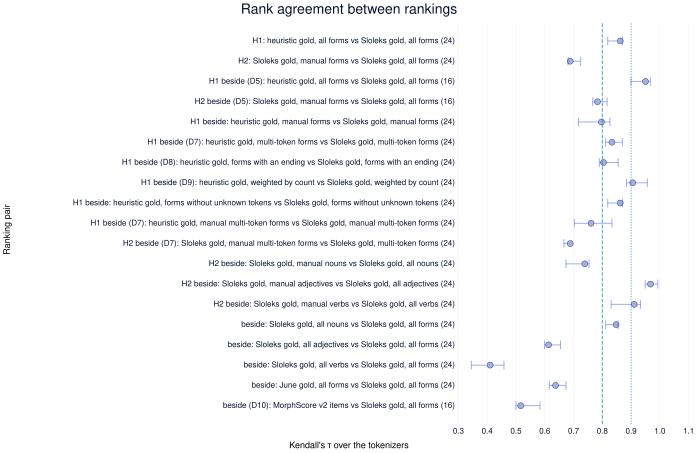
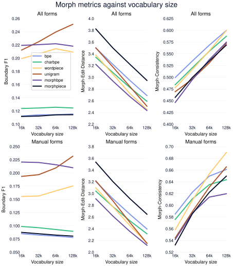
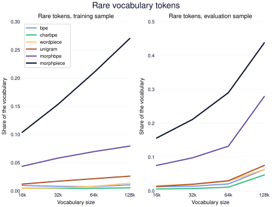

# Whether the Sloleks 3.2 stem-ending split ranks Slovene tokenizers as the lemma-alignment gold does

## TL;DR

- **Hypothesis**: partial (concluded 2026-10-25) — the stem-ending split of the Sloleks authors ranks the tokenizers as the corrected heuristic does, but the manually checked forms rank them differently from all forms, so later morph scores are read on the manually checked forms first.
- **F1 — The heuristic gold and the Sloleks gold rank the tokenizers alike.** The two golds rank the tokenizers with a Kendall's τ of 0.86, and the whole bootstrap interval sits above the 0.8 bar.
- **F2 — The manually checked forms rank the tokenizers differently from all forms.** Ranking the tokenizers on the manually checked forms alone agrees with the all-forms ranking at τ 0.69, below the 0.9 bar.
- **F3 — On all forms only Unigram's morpheme-boundary F1 still rises at the largest vocabulary, while compression and Morph-Edit-Distance keep improving for every algorithm.** From 64k to 128k every algorithm still gains on fertility and Morph-Edit-Distance, but on all forms morpheme-boundary F1 rises for Unigram alone.
- **Next**: the programme's next experiment, on new morph metrics, scores on the Sloleks gold with the manual forms first and each word class beside the pooled score.

## Hypothesis

- **Statement**: the tokenizers rank the same on morpheme-boundary F1 whether the gold is the project's lemma-alignment heuristic, with its word-class tags corrected, or the stem-ending split that the Sloleks 3.2 authors released. Scoring on the manually checked forms alone gives the same ranking as scoring on all forms.
- **Rationale**:
  - **The morph metrics so far rest on a heuristic gold.** The heuristic aligns each inflected form to its lemma (dictionary form) and cuts where they first differ, with rules for the usual stem changes. The June sweep notes call it silver gold and read its scores only as relative comparators between tokenizers.
  - **That heuristic never split a noun.** It keeps a form whole when the form's morphosyntactic tag starts with a letter it takes for an invariant word class. Those letters follow the English tag set, where `S` is a preposition, but Sloleks uses the Slovene tag set, where `S` is a noun. The June scores therefore measured mostly verbs and adjectives, and the morpheme table that MorphBPE and MorphPiece train on held no noun splits.
  - **Sloleks 3.2 gives a split from the lexicon's own authors.** Each inflected form is cut into the stem shared by its whole paradigm and the ending, from the inflection patterns of the lexicon. About 30% of the forms are manually checked, and the rest are generated automatically. It covers inflection only, not derivation or compounding.
  - **The two golds cut differently even where the heuristic does cut.** The heuristic stops at the first difference from the lemma, so a fleeting vowel or an augment moves the cut: the heuristic gives *binokularn·a*, Sloleks 3.2 gives *binokular·na*. If such cuts reorder the tokenizers, the June morph conclusions do not hold.
  - **The data can carry the bars, by the counts on disk.** Sloleks 3.2 holds 2.89 million distinct forms in nouns, adjectives, verbs and adverbs, 0.86 million of them on manually checked lexemes. Of the 2.80 million forms both golds cover, the uncorrected heuristic agrees on the cut in 23%, mostly verbs and adjectives, and leaves 91% of nouns unsplit. Holding out a fifth of the lexemes leaves about half a million scored forms. Counts in [forms per word class and checking status](tables/scoping-gold-by-pos.csv).
- **Predictions**: every clause is read on the 24 tokenizers (six algorithms at 16k, 32k, 64k and 128k vocabulary), trained on the training side of the corpus split ([D2], [D3]). Each is scored on the same held-out forms under each gold, from lexemes no morpheme table saw ([D1], [D4]). Rank agreement is Kendall's τ over the 24 tokenizers on morpheme-boundary F1, with a 95% bootstrap interval over lexemes ([D6]).
  - **H1 — The heuristic gold and the Sloleks 3.2 gold rank the tokenizers alike**: confirmed if τ between the two rankings is at least 0.8; refuted if it is below 0.8 — the heuristic's cut placement then decides which tokenizer looks morphologically best, and only the authors' split can serve as gold.
  - **H2 — The manually checked forms rank the tokenizers as all forms do**: confirmed if τ between the manual-only and the all-forms ranking under Sloleks 3.2 is at least 0.9; refuted if it is below 0.9 — errors in the automatic rows then move the ranking, and the manual-only score becomes the primary one.
  - **Q1 — Which metrics still improve as the vocabulary grows, and which have levelled off by 128k?**: read on the curves of every metric against vocabulary size per algorithm (fertility, compression, Rényi efficiency, and the three morph metrics under Sloleks 3.2). A metric has levelled off for an algorithm when its gain from 64k to 128k is under a quarter of its gain from 16k to 32k. Robust if each morph metric's reading is the same on the manual-only and the all-forms score — the answer sets the vocabulary sizes the later tokenizer experiments train.
  - **Verdict rule**: confirmed when H1 and H2 both hold; refuted when H1 is refuted; inconclusive when an interval of τ straddles its bar. H2 refuted with H1 confirmed is the automatic-rows reading: the golds agree, but the score is reported on manual forms first. Q1 is read beside that outcome and does not change it. — Note added 2026-10-25 at conclusion: the automatic-rows reading takes the outcome word partial, since the rule named the reading without a word and a split of the bars takes neither side's word.
  - **Read beside the clauses, not as clauses**: forms scored per gold and slice; τ for H1 and H2 on the 16 tokenizers that train without a morpheme table ([D5]); morpheme-boundary F1 on multi-token forms only ([D7]), without forms that have no ending ([D8]) and weighted by corpus frequency ([D9]); τ against the MorphScore v2 Slovene ranking ([D10]); the share of each vocabulary that occurs rarely in the training and evaluation samples ([D12]); the uncorrected June heuristic's scores, as the size of the tag bug; training time and peak memory of the 128k tokenizers.
- **Outcome**: partial

## Design

- **Inputs**: the shared curated corpus, the Sloleks 3.1 lexicon as the heuristic's source, the Sloleks 3.2 stem-ending split, the Sloleks word relations and the MorphScore v2 Slovene set, described in `## Datasets`.
- **Method / factors**: one pass from a corpus split and two golds to two rank agreements.
  - Split the corpus 80/20 by document within each source, and draw a training sample and an evaluation sample from the two sides ([D3], [M1], [M2]).
  - Build the Sloleks 3.2 gold, one form per row, and mark each form manual or automatic ([D1], [M3]).
  - Build the heuristic gold from Sloleks 3.1 with the Slovene word-class tags ([M4]).
  - Split the lexemes 80/20, build the morpheme table from the training side, and keep the held-out forms for scoring ([D4], [M5]).
  - Train the six algorithms at four vocabulary sizes on the training sample, the character-level ones on a capped alphabet ([D2], [D14], [M6]).
  - Score all 24 tokenizers on the held-out forms under each gold and slice, and on the evaluation sample for the corpus metrics ([M7]).
  - Rank the tokenizers per gold and slice, and compute τ with its interval for H1 and H2 ([M8]).
  - Factors: the gold (corrected heuristic, Sloleks 3.2) and the slice (manual, all) are scientific. The algorithm and the vocabulary size span the population being ranked. The training sample and the morpheme table are fixed ([D2]).
- **Metrics**: primary Kendall's τ between tokenizer rankings on morpheme-boundary F1; secondary Morph-Edit-Distance, Morph-Consistency, fertility, compression and Rényi efficiency — each defined in `experiments/GLOSSARY.md`.
- **Protocol**: training each of the 24 tokenizers is one tracked run. Scoring is deterministic and recomputed by `analysis.py` from the tokenizer files, the golds and the evaluation sample, with no further runs.
- **Compute**: local CPU, four workers at most. One streaming pass over the corpus fixes the split and its statistics. Five algorithms train in minutes to an hour at 64k. MorphBPE's single-threaded merge loop took 31 hours at 128k, which bounds the sweep: all 24 tokenizers trained in 31 hours on four workers.
- **People**: none.
- **Data access**: Sloleks 3.2 is an unreleased file the lexicon's author shared directly; it is cited as Sloleks 3.1 (hdl.handle.net/11356/2080), as the author asked.
- **External dependency**: none.

## Datasets

- **Sloleks stem-ending split**: one item is one lexeme of the Sloleks authors' release `DSBS__inflect_morph_seg__2026-07.tsv`, with its manual or automatic status and each inflected form cut into the paradigm stem and the ending. The authors shared it from the CJVT Nextcloud in July 2026; it is cited as Sloleks 3.1. It is converted to the shared `tokenization/sloleks_inflection.jsonl.gz` and cut into the Sloleks gold by [D1]. [Forms per gold, slice and word class, before and after the cut to shared forms](tables/dataset-morph-golds-statistics.csv)
- **Sloleks 3.1 lexicon**: one item is one lemma of Sloleks 3.1 (CLARIN.SI 11356/2080) with its inflected forms and tags, converted to the shared `tokenization/sloleks.jsonl.gz` in June 2026. The corrected heuristic gold is aligned from it; its rows sit in the same table as the Sloleks gold's.
- **June gold**: the heuristic gold the June sweep saved before the tag fix (`tokenizers/morph_lexicon_infl.jsonl.gz`), read beside the clauses only. The shared sweep registry now builds the corrected gold, so this file is the only copy of the June one. Its rows sit in the same table.
- **Scored-form golds**: the Sloleks, heuristic and June golds cut to the held-out forms all three cover ([D4]), frozen as `final/morph-golds-heldout-forms/` under the experiment's data folder; every tokenizer is scored on these forms. Each form carries the held-out lexeme it is resampled under ([D6]); the lexeme counts sit in the gold table.
- **Held-out form counts**: one item is one scored form with its count in the evaluation sample ([D9]), frozen as `final/heldout-form-counts/`. A form holding a digit or hyphen (`a380`, `APZ-ja`) never matches a run of letters, so it keeps only the weight of one that every form gets before its count is added ([D9]). The forms seen, the forms that can never be counted and the occurrences per word class sit in the gold table.
- **Curated corpus split**: one item is one document of the shared corpus after sentence dedup (`pretrain/06_sentence_dedup`, 18 sources, built 2026-10-08). Each source's documents are split 80/20 into a training and an evaluation side ([D3]), and a sample is drawn from each side. A word here is a whitespace-separated token, so the totals exceed the statistics stage's word counts. [Documents, words and bytes per source and side, for the split and the samples](tables/dataset-corpus-split-statistics.csv)
- **Lexeme split**: the Sloleks 3.2 lexemes split 80/20 within each word class and checking status ([D4]); the morpheme table is built from the training side and the clauses are scored on the held-out forms. [Lexemes and forms per side, word class and status](tables/dataset-lexeme-split-statistics.csv)
- **Sloleks word relations**: one item is one derived lemma of the Sloleks 2.0 word relations (CLARIN.SI 11356/1986) cut into morphemes, converted to the shared `tokenization/sloleks_relations.jsonl.gz`; it joins the morpheme table only.
- **MorphScore v2 Slovene set**: one item is one word form from the Slovene UD treebank SSJ, cut into stem and affixes by its longest substring shared with the lemma (Arnett, Hudspeth & O'Connor 2025, arXiv:2507.06378). It is downloaded from the authors' Hugging Face dataset at the revision of 2025-07-10 (CC BY-SA 4.0) and converted to the shared `tokenization/morphscore_slovenian.jsonl.gz`. MorphScore v2's default filters keep the first occurrence of each item, with its stem equal to its lemma and no digit in the form. The result is frozen as `final/morphscore-slovene-items/` and scores the 16 tokenizers without a morpheme table as an outside gold ([D10]). [Items through each filter and per part of speech](tables/dataset-morphscore-statistics.csv)

## Methods

### M1 — Split every source's documents 80/20 into a training side and an evaluation side

- **Input**: the shared curated corpus `pretrain/06_sentence_dedup/`, one JSONL record per document with its `id` and `text`, in one folder per source (18 sources).
- **Output**: `corpus_split.json` in the experiment's `final/sweep-vocab-size/`: one rank threshold per source, the documents, words and bytes on each side, and a fingerprint of the corpus shard set. It is the input of [M2].
- **How**:
  1. Each document gets a rank: the first eight bytes of the BLAKE2b hash of `<source>/<id>`, read as an integer.
  2. Within each source the documents are sorted by rank, and the first $n_{\text{train}} = \operatorname{round}(N \cdot s)$ form the training side, where $N$ is the source's document count and $s$ is `corpus.split.train_share`. The rank of the next document is the source's threshold, so a document's side follows from its rank alone.
  3. The fingerprint is a SHA-256 hash over every shard's path, size and modification time. A later step that reads the corpus refuses the split when the fingerprint differs, since the corpus changed under it. Training reads only the sample, so it does not check.
  4. The split is by id, so two documents with the same text but different ids can sit on different sides ([D3]).
- **Code**: `slm4ie/tokenizers/corpus.py::fit_corpus_split`
- **Settings**: `corpus.root` (the corpus folder), `corpus.split.train_share` (share of each source on the training side), in `configs/sweep-vocab-size.yaml`

### M2 — Draw a training sample and an evaluation sample in proportion to each side's sources

- **Input**: the corpus and the split of [M1].
- **Output**: `corpus_sample.txt.gz` (training) and `eval_sample.txt.gz` (evaluation), one document text per line, each with a `.sources.json` sidecar giving the side and the documents, words and bytes drawn per source. The training sample feeds the tokenizer training of [M6]; the evaluation sample feeds the corpus metrics.
- **How**:
  1. Each source's quota is the byte budget times the source's share of that side's bytes.
  2. Each source's shards are read in an order shuffled by the side's seed, and only documents on the side are taken, until the quota is met.
  3. A sample reused later is refused if its sidecar names the other side. Training and scoring never redraw a sample, even when forced; only the `sample --force` step does.
- **Code**: `slm4ie/tokenizers/corpus.py::materialize_sample`
- **Settings**: `corpus.budget.max_bytes` (training budget, 2 GB), `corpus.budget.seed` (training shuffle seed), `eval.corpus_budget.max_bytes` (evaluation budget, 200 MB), `eval.corpus_budget.seed` (evaluation shuffle seed), `corpus.budget.source_weights` (empty: proportional to the side's bytes), in `configs/sweep-vocab-size.yaml`

### M3 — Build the Sloleks 3.2 gold, one stem-ending cut per form

- **Input**: `tokenization/sloleks_inflection.jsonl.gz`, one record per lexeme (a dictionary entry with its whole paradigm) carrying its entry id, word class, manual or automatic status, and each form already cut as stem and ending, such as *mačk·ah*.
- **Output**: a gold mapping each distinct form to its cut, its tag and a `verified` flag. It is the input of [M5].
- **How**:
  1. Every form of every lexeme is read with its cut.
  2. A form that two lexemes cut differently has no single gold cut, so it is dropped and counted ([D1]).
  3. A form with no ending is kept as one stem ([D8]).
  4. A form is `verified` (manual) only when every lexeme carrying it was checked by hand.
- **Code**: `slm4ie/tokenizers/morphology.py::build_inflection_lexicon`
- **Settings**: `morphology.inflection_path` (the converted stem-ending split), in `configs/sweep-vocab-size.yaml`

### M4 — Build the heuristic gold by aligning each form to its lemma

- **Input**: `tokenization/sloleks.jsonl.gz`, one Sloleks 3.1 record per lemma (dictionary form) with its forms and their morphosyntactic tags.
- **Output**: a gold mapping each form to a stem and a suffix, or to one whole stem. It is the reference arm of H1 and the inflectional half of the morpheme table in [M5].
- **How**:
  1. A form whose tag starts with an invariant word class (`D`, `V`, `L`, `M`, `O` in the Slovene tag set: preposition, conjunction, particle, interjection, abbreviation) or that holds a space is kept whole.
  2. Otherwise the cut is where the lowercased form first departs from the lowercased lemma, with rules for the usual stem changes.
  3. A form that is the lemma, or a prefix of it, is one stem. A cut shorter than `min_stem_len` letters is untrusted, and the form is kept whole and marked so.
  4. A form that two lemmas cut differently keeps its first cut and is counted as a collision.
- **Code**: `slm4ie/tokenizers/morphology.py::build_morph_lexicon`
- **Settings**: `morphology.sloleks_path` (the converted Sloleks 3.1 lexicon), `morphology.min_stem_len` (shortest stem trusted, 2 letters), in `configs/sweep-vocab-size.yaml`

### M5 — Hold out a fifth of the lexemes, build the morpheme table from the rest, and cut the golds to held-out forms

- **Input**: the stem-ending split of [M3]'s input, the golds of [M3] and [M4], and the Sloleks word relations, whose derivational splits join the table.
- **Output**: the morpheme table `morph_lexicon.jsonl.gz`, read by MorphBPE and MorphPiece in [M6], and the scored golds in `final/morph-golds-heldout-forms/`, each form with its lexeme id.
- **How**:
  1. Lexemes are grouped by word class and status. Within each group they are ordered by the hash rank of their entry id, and the lowest `heldout_lexeme_share` of each group is held out, so a whole paradigm sits on one side.
  2. A held-out form that a training-side lexeme also carries is dropped from scoring ([D4]).
  3. Each scored form is assigned one held-out lexeme, the unit the bootstrap resamples ([D6]). Among several carriers the lowest hash rank of form and entry id wins.
  4. The table is the derivational splits merged with the heuristic gold, minus every scored form. Training on a table that holds a scored form is refused.
  5. The golds are cut to the scored forms every gold covers.
- **Code**: `slm4ie/tokenizers/morphology.py::split_lexemes`
- **Settings**: `morphology.heldout_lexeme_share` (share of each group held out, 0.2), `morphology.sloleks_relations_path` (the word relations), in `configs/sweep-vocab-size.yaml`

### M6 — Train the six algorithms at four vocabulary sizes on the training sample, with their lineage

- **Input**: the training sample of [M2] and, for MorphBPE and MorphPiece, the morpheme table of [M5].
- **Output**: one tokenizer folder per algorithm and size under `final/sweep-vocab-size/<algorithm>-<size>/`, with its training time and peak memory, and one MLflow child run per tokenizer.
- **How**:
  1. Each of the 24 runs trains its backend on the same training sample with the same special tokens. Unigram first cuts each document at whitespace into pieces of at most 4,192 bytes ([D13]). Character BPE, WordPiece, MorphBPE and Unigram take as base characters only those covering 99.99% of the sample's character occurrences ([D14]). The alphabet is counted once on the sample after NFC, without whitespace. The other characters leave the training text; at inference they encode as `<unk>`, and WordPiece turns a whole word holding one into `<unk>`. Byte-level BPE, character-level BPE, WordPiece and Unigram ignore the table. MorphBPE forbids merges across the table's morpheme boundaries, and MorphPiece splits table words by the table before byte-level BPE.
  2. Each run logs its algorithm, vocabulary size, the sample's seed, training seconds, and the corpus and held-out shares. The trainers themselves take no seed and are deterministic. It also logs the content hashes of the split, the training sample and the table, so a run names the exact inputs it saw.
  3. Peak memory is the highest resident memory of the training process, read once a second while the backend trains.
  4. The runs are queued MorphBPE and MorphPiece first, largest vocabulary first, so the slowest start at once.
  5. Each run carries the labflow tags `tier`, `branch`, `base_commit`, `type` and `language`. A tokenizer trained by a run that stopped before logging is logged by the next run that skips it.
- **Code**: `slm4ie/tokenizers/train.py::train_sweep`
- **Settings**: `tokenizers` (the six algorithms), `vocab_sizes` (16k, 32k, 64k, 128k), `special_tokens` (tokens reserved in every vocabulary), `character_coverage` (the share of character occurrences the base alphabet covers), `mlflow.tags` (the fixed run tags), in `configs/sweep-vocab-size.yaml`

### M7 — Score every tokenizer on the held-out forms under each gold and on both samples

- **Input**: the 24 tokenizer folders of [M6], the MorphScore v2 items and the two samples of [M2]. The scored golds of [M5] hold one row per held-out form, with the same forms in the same order under the Sloleks, heuristic and June gold.
- **Output**: per tokenizer, an array file with its per-form counts and a summary with Morph-Consistency, the corpus metrics, the unknown-token counts and the count bins of [D12], under the experiment's `interim/tokenizer-scores/`. It is the input of [M8].
- **How**:
  1. Each scored form is encoded once. Its tokens give the number of tokens and the unknown tokens among them, where an unknown token is the `<unk>` token or a piece outside the vocabulary.
  2. Under each gold the token boundaries inside the form are compared with the gold's, giving the counts of shared, predicted and gold boundaries. The edit distance is the number of insertions, deletions and substitutions that turn the tokens into the gold morphemes. A form whose tokens do not tile its surface text is marked invalid.
  3. Morph-Consistency is computed once on all scored forms and once on the manual ones ([D11]).
  4. Each sample is split into words, and the tokenizer encodes every distinct word once, weighted by its count. From those tokens follow fertility, tokens per byte, characters per token and the Rényi efficiency of order $\alpha$, read from `eval.renyi_alpha`, and every vocabulary token's count, binned by `scoring.count_bins` ([D12]). Special tokens are left out.
  5. A tokenizer is rescored only when a digest of the golds, the samples, the settings and the scoring code changes.
- **Code**: `experiments/validation/morph-gold-slovenian/analysis.py::score_tokenizer`
- **Settings**: `scoring.max_workers` (tokenizers scored at once), `scoring.count_bins` (lower edges of the count bins), in `configs/analysis.yaml`; `eval.renyi_alpha` (the Rényi order), `special_tokens` (tokens left out of the counts), in `configs/sweep-vocab-size.yaml`

### M8 — Rank the tokenizers per gold and slice, and compute Kendall's τ with a lexeme bootstrap

- **Input**: the per-form counts of [M7] for all 24 tokenizers, each scored form's held-out lexeme from [M5], and each form's count in the evaluation sample ([D9]).
- **Output**: the seven `tables/sweep-*.csv` tables and the five `figures/sweep-*.svg` figures the findings cite; the figures are also attached to the sweep's parent run in MLflow.
- **How**:
  1. Only forms every tokenizer tiles, meaning its tokens joined give the form back exactly, are scored ([D7]). A reading is a gold, a mask over the forms (all, manual, multi-token, with an ending, without unknown tokens, or one word class) and a per-form weight: one, or the evaluation-sample count plus one ([D9]).
  2. Per reading and tokenizer, the shared, predicted and gold boundary counts are summed per lexeme. Morpheme-boundary F1 is $F_1 = 2\,\mathrm{TP} / (P + G)$, where $\mathrm{TP}$, $P$ and $G$ are the summed shared, predicted and gold boundaries.
  3. Each of `stats.n_resamples` bootstrap draws resamples the lexemes with replacement, so a lexeme's weight is how many times it was drawn, and recomputes F1 ([D6]). The MorphScore items carry no lexeme, so they are resampled as items. Readings over the same lexemes share the draws, so both rankings of one pair come from the same resampled lexemes.
  4. Kendall's τ between two rankings is computed on the point F1 and on every paired draw; the interval is the central `stats.ci_level` of the draws. The 16-tokenizer readings drop the two table-trained algorithms ([D5]).
  5. Q1's rule takes, per metric, slice and algorithm, the gain from 16k to 32k and from 64k to 128k in the metric's better direction. The metric has levelled off when the late gain is under `scoring.levelled_ratio` of the early one, falls when it is negative, and has no early gain when the early one is not positive.
- **Code**: `experiments/validation/morph-gold-slovenian/analysis.py::build_scores`
- **Settings**: `stats.n_resamples` (bootstrap draws), `stats.ci_level` (central mass of each interval), `stats.seed` (seed of the draws), in `configs/sweep-vocab-size.yaml`; `scoring.levelled_ratio` (the Q1 levelling share), `scoring.rare_below` (the count under which a vocabulary token is rare), in `configs/analysis.yaml`

## Decisions

### D1 — Score one row per distinct form and drop forms the lexicon splits two ways

- **Decision**: Sloleks 3.2 repeats a form once per morphosyntactic tag; each (lexeme, form) pair is kept once. A form that two lexemes split differently is dropped from both golds. A form with no ending stays in, as a form that should not be split. A form is manual when every lexeme carrying it is manually checked.
- **Why**: a form counted once per tag would weight long paradigms; a form with two gold cuts has no single right answer. The 74,000 forms split two ways are 2.6% of the lexicon.
- **History**:
  - 2026-10-22 set at the start, from the scoping counts.

### D2 — Retrain all 24 tokenizers on one new sample, with a morpheme table from the corrected heuristic

- **Decision**: all six algorithms train at 16k, 32k, 64k and 128k on the training sample of the corpus split ([D3]). MorphBPE and MorphPiece use one morpheme table: the corrected heuristic's cuts plus the word-relation splits, with every scored form removed ([D4]).
- **Why**: the June sample came from an earlier corpus build, so the June tokenizers cannot join a sweep on the current one. The corrected heuristic is the morphological algorithms' own method with its bug fixed; a table from the Sloleks split is a method change, planned as its own experiment.
- **Alternatives**:
  - Reuse the 18 June tokenizers and train only 128k: they were trained on an older corpus.
  - Build the table from the Sloleks split: favours the Sloleks gold by construction.
- **History**:
  - 2026-10-22 set at the start: train only 128k on the June sample and the June table.
  - 2026-10-22 changed before any run: the corpus was rebuilt since June, so the whole sweep is retrained on a new sample with a held-out evaluation side.
  - 2026-10-23 worded as built before any run: the table removes the scored forms, not whole lexemes, so it keeps Sloleks 3.1 forms that 3.2 lacks.

### D3 — Split the corpus 80/20 by document within each source, and sample each side in proportion to its sources

- **Decision**: each document is ranked by a hash of its source and id; within each source, the lowest 80% go to training and the rest to evaluation. A 2 GB training sample and a 200 MB evaluation sample are drawn from the two sides, each source taking its share of that side's bytes.
- **Why**: exact per-source proportions keep small sources on both sides. A held-out side means no evaluated document was seen in training, by id. The same text under two ids can still sit on both sides; the data review found 34 such lines in the training sample. A hash rank is reproducible without storing 30 million ids.
- **Alternatives**:
  - Split one 2.5 GB sample: the evaluation side would be one small draw, not reusable.
  - Weight sources equally, as the June sampler did: a 367-document source would weigh as much as the largest web crawl.
- **History**:
  - 2026-10-22 set with the user before any run.
  - 2026-10-23 worded as built before any run: the source shares are by bytes, as the sampler draws them.

### D4 — Split the lexemes 80/20 within each word class and status, and score only held-out forms

- **Decision**: Sloleks 3.2 lexemes are split 80/20 by a hash of their id, exactly within each word class and checking status. A held-out form that also occurs in a training lexeme is dropped from scoring. The morpheme table drops every scored form, and keeps the forms a training lexeme shares with a held-out one.
- **Why**: MorphPiece emits the table's cuts for words it knows and MorphBPE trains on them, so a form in the table is scored on memory. Splitting lexemes, not forms, keeps the whole paradigm on one side. Published form-level splits leak: 69% of SIGMORPHON 2022 English inflected test words have their base in training.
- **Alternatives**:
  - Split by form, as SIGMORPHON 2022 and MorphBPE do: forms of one paradigm land on both sides.
- **History**:
  - 2026-10-22 set with the user before any run, after the data review found the table covered every scored form.
  - 2026-10-22 precedent added after a literature comparison: only BPE-knockout's lemma holdout and DagoBERT's held-out bases split above the form.
  - 2026-10-22 table rule worded as built, before any run: the table keeps shared forms, which are never scored.

### D5 — Report the rank agreements also without the two algorithms that train on a morpheme table

- **Decision**: beside H1 and H2 on all 24 tokenizers, τ is reported on the 16 tokenizers of BPE, character BPE, WordPiece and Unigram.
- **Why**: with held-out lexemes no form is memorised, but the table still teaches heuristic-style endings, which may favour the heuristic gold. If the two readings differ, the table explains the difference rather than the gold.
- **History**:
  - 2026-10-22 set with the user before any run.

### D6 — Resample lexemes, not forms, for every bootstrap interval on the morph metrics

- **Decision**: per-form counts are summed per held-out lexeme, and each bootstrap draw resamples lexemes. A form carried by two held-out lexemes counts under the one its hash picks. The intervals on τ for H1 and H2 come from these draws.
- **Why**: the forms of one paradigm share a stem and are cut alike, so they are not independent. Resampling about half a million forms would give an interval too narrow to straddle a bar.
- **Alternatives**:
  - Resample forms, as the code did: treats correlated forms as independent and overstates certainty.
- **History**:
  - 2026-10-22 set with the user before any run, after a literature comparison.

### D7 — Score every tokenizer on all held-out forms, including those it keeps as one token

- **Decision**: the primary score counts a form the tokenizer leaves whole as one with its gold boundary missed. Morpheme-boundary F1 on multi-token forms only is read beside the clauses.
- **Why**: τ needs every tokenizer ranked on the same forms. At 128k many frequent forms are one token, so the beside reading separates boundary placement from vocabulary coverage.
- **Alternatives**:
  - Exclude one-token forms, as MorphScore v1 does: each tokenizer is then scored on its own subset.
  - Keep only forms whose gold pieces are vocabulary entries, as Uzan et al. and FLOTA do: also per-tokenizer subsets.
- **History**:
  - 2026-10-22 set with the user before any run, after a literature comparison.

### D8 — Keep forms with no ending, and read the score without them beside the clauses

- **Decision**: a form whose gold has no ending stays in the scored set as a form that should not be split ([D1]). Morpheme-boundary F1 without these forms is read beside the clauses.
- **Why**: splitting such a form is a real tokenizer fault, and these forms only lower precision. The beside reading shows whether over-splitting moves the ranking.
- **Alternatives**:
  - Drop them, as MorphScore v2 and Bostrom & Durrett do: precision would then ignore over-splitting.
- **History**:
  - 2026-10-22 set with the user before any run, after a literature comparison.

### D9 — Read a frequency-weighted morpheme-boundary F1 beside the type-level clauses

- **Decision**: each held-out form is weighted by its count in the evaluation sample plus one ([D3]). A counted word is a maximal run of letters, matched to the form lowercased; forms that differ only in case share a count. The weighted F1 is read beside the clauses; H1, H2 and Q1 stay on the unweighted, one-count-per-form score.
- **Why**: BPE-knockout and Bostrom & Durrett weight by corpus frequency, and the weighted score reacts to leakage very differently from the type-level one. The add-one keeps forms absent from the sample.
- **Alternatives**:
  - Read H1 on the weighted score too: doubles the verdict surface for a score dominated by short frequent forms.
- **History**:
  - 2026-10-22 set with the user before any run, after a literature comparison.

### D10 — Score the tokenizers without a morpheme table on the MorphScore v2 Slovene set as an outside gold

- **Decision**: the 16 tokenizers of [D5] are scored on the MorphScore v2 Slovene items, and τ between that ranking and the Sloleks 3.2 ranking is read beside the clauses.
- **Why**: the set is cut by a different method from different text, so agreement shows the ranking is not a Sloleks artefact. Its lemmas were never held out, so the two table algorithms could score on memory.
- **Alternatives**:
  - Score all 24 on the items whose lemma is a held-out lexeme: keeps every algorithm, leaves about a fifth of the items.
- **History**:
  - 2026-10-22 set with the user before any run, after a literature comparison.

### D11 — Draw Morph-Consistency pairs from each shared morpheme, at most 200 pairs per morpheme

- **Decision**: Morph-Consistency pairs every two scored forms that share a gold morpheme or a token, capped at 200 sampled pairs per morpheme or token. It is a point estimate with no interval.
- **Why**: on a stem-ending gold a shared morpheme is a stem or an ending. A few hundred endings give few pairs and about 100,000 stems give many, so the score mostly asks whether a paradigm keeps its stem token.
- **Alternatives**:
  - MorphBPE's k-means sampling, 50 pairs per cluster: its clusters have no clear meaning on a two-morpheme gold.
  - Separate stem and ending consistency: one more metric for a secondary reading.
- **History**:
  - 2026-10-22 set with the user before any run, after a literature comparison.

### D12 — Count how often each vocabulary token occurs in both samples, and read the rare share beside Q1

- **Decision**: each of the 24 tokenizers encodes both samples ([D3]) and counts every vocabulary token per sample. A table per tokenizer and sample puts the vocabulary in the count bins 0, 1–9, 10–99, 100–999 and 1,000 or more. Each bin shows its share of the vocabulary and of the sample's tokens. The rare share is read beside Q1.
- **Why**: a token seen only a few times gives a language model too few examples to learn its embedding. A 128k vocabulary that gains on the morph metrics but holds many such tokens may still be the worse choice for a small model. Counts per million tokens carry the reading to a pretraining corpus of any size.
- **Alternatives**:
  - A bar on the rare share: no level can be set before the counts exist, so it stays a reading.
  - Count on the whole training side of the corpus: ten times the encoding cost for counts the per-million scale already gives.
- **History**:
  - 2026-10-23 set with the user before any run.

### D13 — Cut each document into pieces SentencePiece accepts before Unigram trains on it

- **Decision**: Unigram trains on every document, cut at whitespace into pieces of at most 4,192 bytes. The other five algorithms read whole documents.
- **Why**: SentencePiece drops any line longer than 4,192 bytes, and the sample holds one document per line. Uncut, Unigram would train on 41% of the sample's bytes, mostly short documents with a different source mix. The June Unigram tokenizers had this loss, so their scores are not comparable.
- **Alternatives**:
  - Raise SentencePiece's line limit: long lines strain its memory, and a cut at a space loses only cross-piece pairs.
- **History**:
  - 2026-10-23 set before any run, after the pre-launch review measured the loss.

### D14 — Give the character-level algorithms only the characters that cover 99.99% of the sample

- **Decision**: character BPE, WordPiece, MorphBPE and Unigram take as base characters the most frequent ones that together cover 99.99% of the training sample's character occurrences: the same 236 of 6,074 for all four. The other characters encode as `<unk>`. Unigram gets this alphabet, not SentencePiece's own coverage, which counts spaces and NFKC forms. Byte-level BPE and MorphPiece keep their 256 bytes.
- **Why**: with every character kept, 5,369 of Unigram's 16,000 pieces were single characters, mostly other scripts, private-use and mis-decoded text. The byte-level algorithms pay no such cost, so the 16k ranking would partly measure the alphabet. At 99.95%, SentencePiece's default, ü, ö, á, đ and Ć drop out and 0.98% of the Sloleks forms hold one; at 99.99%, 0.057% do.
- **Alternatives**:
  - Keep every character, as the libraries do by default: a third of a 16k vocabulary goes to single characters.
  - Cover 99.95%: drops letters of names the gold scores.
  - Clean the corpus first: a curation rebuild of several days, planned on its own.
- **History**:
  - 2026-10-23 set with the user before any tracked run, after the smoke run counted the single-character pieces. 99.99% was chosen over the proposed 99.95% after counting the forms each drops.

## Findings

### F1 — The heuristic gold and the Sloleks gold rank the tokenizers alike · key

- **Summary**: The two golds rank the tokenizers with a Kendall's τ of 0.86, and the whole bootstrap interval sits above the 0.8 bar.
- **Runs**: 73b5a885e4bf4f2994b285573dab10ee (the sweep's parent run, 24 child runs), scored by `analysis.py` at 8f408e8 on the scored-form golds
- **Result**: 
- **Reading**:
  - **Both golds put the same algorithms at the top and the same at the bottom.** Under either gold Unigram ranks above MorphBPE, which ranks above WordPiece, and a gap separates those three from character BPE, BPE and MorphPiece. The disagreement sits inside an algorithm, where its four vocabulary sizes swap places. On the tokenizers that train without a morpheme table the agreement rises to 0.95. The frequency-weighted and the multi-token readings agree with the main one, while the manual-only reading and the forms with an ending have intervals that cross the bar.
  - **The claim that the two golds rank the tokenizers alike ([H1]) is confirmed, since τ and its whole interval lie above the bar of 0.8.** The corrected heuristic places its cut differently from the authors' split on many forms, yet which tokenizer looks morphologically best does not depend on that placement.
  - **A vocabulary-size order that reversed between the golds inside one algorithm would overturn the reading.** The scatter shows each algorithm's four points moving along the diagonal, so the gold shifts a score without reordering the family.
- **Implication**: The tokenizer sweep of June 2026, written up in `docs/notes/`, rests on the uncorrected gold, whose ranking agrees with the Sloleks one at only τ 0.64. The later experiments score on the Sloleks gold and reread the June comparisons on it.
- **History**:
  - 2026-10-25 first result, run 73b5a885e4bf4f2994b285573dab10ee, analysis commit 8f408e8.

### F2 — The manually checked forms rank the tokenizers differently from all forms · key

- **Summary**: Ranking the tokenizers on the manually checked forms alone agrees with the all-forms ranking at τ 0.69, below the 0.9 bar.
- **Runs**: 73b5a885e4bf4f2994b285573dab10ee, scored by `analysis.py` at 8f408e8 on the scored-form golds
- **Result**: 
- **Reading**:
  - **On the manual forms MorphBPE overtakes Unigram at every size but the largest, and the algorithms that train without a morpheme table score higher with smaller vocabularies.** On all forms Unigram leads from 32k upwards and BPE, character BPE and MorphPiece improve as the vocabulary grows. On the manual forms their order by size reverses, so a larger vocabulary scores lower on the forms the lexicon's authors checked.
  - **The claim that the manual slice ranks the tokenizers as all forms do ([H2]) is refuted, since the whole interval ends below the bar of 0.9.** By the verdict rule this is the automatic-rows reading: the golds agree, but the morph score is reported on the manual forms first.
  - **A manual slice drawn at random from all forms would have to agree with them, and only noise could then separate the rankings.** The slice is not random: its word-class mix differs from the whole, which is where the disagreement comes from ([F4]).
- **Implication**: Every morph score of the later tokenizer experiments is reported on the manually checked forms first, with the all-forms score beside it, since the automatic rows move the ranking.
- **History**:
  - 2026-10-25 first result, run 73b5a885e4bf4f2994b285573dab10ee, analysis commit 8f408e8.

### F3 — On all forms only Unigram's morpheme-boundary F1 still rises at the largest vocabulary, while compression and Morph-Edit-Distance keep improving for every algorithm · key

- **Summary**: From 64k to 128k every algorithm still gains on fertility and Morph-Edit-Distance, but on all forms morpheme-boundary F1 rises for Unigram alone.
- **Runs**: 73b5a885e4bf4f2994b285573dab10ee, scored by `analysis.py` at 8f408e8 on the scored-form golds and the evaluation sample
- **Result**: 
- **Reading**:
  - **Compression and edit distance have not levelled off for any algorithm, and Rényi efficiency falls at every step.** Over the last size step, fertility and compression still gain half to three quarters of what they gained over the first, for all six algorithms. Morph-Edit-Distance gains as much over the last step as over the first. Rényi efficiency, how evenly the tokens are used, falls at every step, which the rule records as no early gain. Morpheme-boundary F1 rises at the largest size for Unigram on both slices and for WordPiece on the manual forms only. On all forms it falls for WordPiece, character BPE and MorphBPE and barely moves for the rest. Each reading is in `sweep-levelling-by-algorithm.csv`.
  - **The question which metrics still improve as the vocabulary grows ([Q1]) is partial: compression and Morph-Edit-Distance improve for every algorithm on both slices, but the other two morph metrics do not read alike.** Morpheme-boundary F1 or Morph-Consistency reads differently on the manual and the all-forms score for every algorithm but Unigram. The compression answer is robust; the morph answer holds for Unigram only.
  - **A larger vocabulary that bent Unigram's curve down, or a band rule in place of the quarter rule, would overturn the reading.** A band rule reads a change narrower than its bootstrap interval as flat. The other algorithms' changes at the largest size are that narrow, so a band would call them flat, not falls.
- **Implication**: The later tokenizer experiments keep 128k in the sweep for Unigram and for compression, and read a morpheme-boundary F1 change narrower than its interval as flat rather than by the quarter rule.
- **History**:
  - 2026-10-25 first result, run 73b5a885e4bf4f2994b285573dab10ee, analysis commit 8f408e8.

### F4 — The manual slice reorders the tokenizers through its word-class mix · supporting F2

- **Summary**: Within a word class the manual and the all-forms rankings agree at τ above 0.9 for adjectives and verbs, but the classes disagree.
- **Runs**: 73b5a885e4bf4f2994b285573dab10ee, scored by `analysis.py` at 8f408e8 on the scored-form golds
- **Result**: [Kendall's τ, its interval and its bar for every pair of rankings, the word-class pairs included](tables/sweep-rank-agreement-by-ranking-pair.csv)
- **Reading**:
  - **The disagreement lies between word classes, not between the checked and the unchecked rows of one class.** The manual and the all-forms rankings agree for adjectives and verbs and less for nouns, where τ is 0.74. The verbs alone rank the tokenizers far from the all-forms order, τ 0.41, so the pooled ranking is mostly the nouns' ranking.
  - **For the manual slice's disagreement with all forms ([F2]) this means the slice disagrees because nouns are nearly three quarters of all scored forms but under half of the manual ones.** The all-forms ranking follows the nouns, and the manual ranking gives adjectives and verbs more weight.
  - **A within-class agreement as low as the cross-slice one would overturn the reading, since the automatic rows themselves would then move the ranking.** Nouns come closest, so an audit of the automatic noun rows is the one check left.
- **Implication**: A later gold reports the morph score per word class beside the pooled one, since the pooled ranking follows the class mix of whichever slice is scored.
- **History**:
  - 2026-10-25 first result, run 73b5a885e4bf4f2994b285573dab10ee, analysis commit 8f408e8.

### F5 — The vocabularies trained with a morpheme table carry the most rarely used tokens · minor

- **Summary**: At the largest vocabulary, tokens seen fewer than ten times in the training sample are about 1% of BPE's vocabulary and 27% of MorphPiece's.
- **Runs**: 73b5a885e4bf4f2994b285573dab10ee, scored by `analysis.py` at 8f408e8 on both corpus samples
- **Result**: 
- **Reading**: A vocabulary trained on a morpheme table spends tokens on morphemes the corpus rarely uses, and a small model learns little for those embeddings, so this share ([D12]) weighs against MorphBPE and MorphPiece.
- **History**:
  - 2026-10-25 first result, run 73b5a885e4bf4f2994b285573dab10ee, analysis commit 8f408e8.

### F6 — The capped alphabet touches almost no text and does not move the rankings · minor

- **Summary**: The capped alphabet turns under 0.05% of the sample's tokens into unknown tokens, and dropping the affected forms leaves τ unchanged.
- **Runs**: 73b5a885e4bf4f2994b285573dab10ee, scored by `analysis.py` at 8f408e8 on the scored-form golds and both samples
- **Result**: [Unknown-token share of tokens and of words per tokenizer and sample](tables/sweep-unknown-tokens-by-tokenizer.csv)
- **Reading**: The alphabet cap that keeps the character-level vocabularies from filling up with single characters ([D14]) changes neither τ nor the order of the tokenizers, so it stays in the later sweeps.
- **History**:
  - 2026-10-25 first result, run 73b5a885e4bf4f2994b285573dab10ee, analysis commit 8f408e8.

## Verdict

- **Outcome**: partial — the automatic-rows reading
- **Evidence**: [F1] the two golds rank the tokenizers alike, with τ above its bar; [F2] the manually checked forms rank them differently from all forms, with τ below its bar; [F3] only Unigram's morpheme-boundary F1 still rises at the largest vocabulary, while compression improves everywhere.
- **Discussion**:
  - **The Sloleks 3.2 split ranks the tokenizers as the corrected heuristic does, but which forms are scored matters more than which gold cuts them.** The two golds put the same algorithms in the same order and only swap vocabulary sizes within an algorithm ([F1]). Scoring the manually checked forms alone reorders the tokenizers ([F2]), so the first bar holds and the second fails: the automatic-rows reading the Verdict rule named.
  - **The reordering is a word-class effect the design did not anticipate.** The manual slice holds about half the share of nouns that all forms hold, and the word classes rank the tokenizers apart ([F4]). A pooled morph score therefore follows the class mix of the scored set, and is only comparable between sets with the same mix.
  - **The verdict rule named this split without an outcome word, and the levelling rule reads noise as movement.** The split takes the word partial, added to the rule at conclusion: yes for the gold, no for the slice. Q1's quarter rule turns morpheme-boundary F1 changes narrower than their intervals into falls or gains ([F3]). A follow-up inherits the Sloleks gold, the manual-first score and a band rule for levelling.
- **Adoption candidate**: the project's shared tokenizer sweep, `scripts/sweep_tokenizers.py`, scores on the Sloleks 3.2 gold with the manual-forms score first. The pieces to lift are the Sloleks gold builder and the lexeme holdout in `slm4ie/tokenizers/morphology.py`, and the Slovene word-class fix in the heuristic gold. The capped alphabet and the Unigram document cut in `slm4ie/tokenizers/train.py` and the lexeme bootstrap of `analysis.py` go with them.
- **Next**:
  - The next experiment, on new morph metrics, reports every morph score on the manual forms first and per word class beside the pooled score. It reads levelling with a band from the bootstrap intervals rather than the quarter rule ([Q1]).
  - A retrain of MorphBPE and MorphPiece with a morpheme table built from the Sloleks split, as its own experiment. MorphBPE at 128k trains for more than a day on one core.
  - An audit of the automatic noun rows of Sloleks 3.2, the class where the manual and the all-forms rankings agree least ([F4]).
  - A curation fix for the NUL characters, byte zero, left in the corpus where a letter was lost upstream; delivery work.
- **Limitations**:
  - Both golds cover inflection only; derivation and compounding are unscored, so a tokenizer that cuts prefixes well gets no credit.
  - Rank agreement is over 24 tokenizers, so τ moves in steps of about 0.007 and its point estimate can sit at the edge of its bootstrap interval.
  - The morpheme table of MorphBPE and MorphPiece comes from the corrected heuristic, so their scores under the Sloleks gold may understate what a table from the Sloleks split would give.
  - Morpheme-boundary F1 is pooled over forms with one count each; the frequency-weighted score was read beside the clauses only.

## Reproduce

The Sloleks 3.2 file sits at `data/raw/sloleks/Sloleks 3.2/DSBS__inflect_morph_seg__2026-07.tsv`, placed by hand, and the curated corpus at `data/pretrain/06_sentence_dedup/`. The lexicon conversions `sloleks`, `sloleks_inflection`, `sloleks_relations` and `morphscore_slovenian` from `configs/data/tokenization.yaml` must exist under `data/tokenization/`.

```bash
export MLFLOW_TRACKING_URI=http://localhost:5555   # the shared server
cd <repo>   # with data/ linked to /vault/data/SLM4IE

# Corpus split, both samples and the morpheme table (commit cd57bce)
uv run python scripts/sweep_tokenizers.py sample --config experiments/validation/morph-gold-slovenian/configs/sweep-vocab-size.yaml --max-workers 4

# Scored golds, held-out form counts, MorphScore items and the dataset tables (commit cd57bce)
uv run --group analysis python experiments/validation/morph-gold-slovenian/analysis.py data

# F1 to F6 — train the 24 tokenizers, tracked (commit 7d81996)
uv run python scripts/sweep_tokenizers.py train --config experiments/validation/morph-gold-slovenian/configs/sweep-vocab-size.yaml --all --tier tracked --max-workers 4

# F1 to F6 — score and rank the tokenizers, and draw every table and figure (commit 8f408e8)
uv run --group analysis python experiments/validation/morph-gold-slovenian/analysis.py scores
```
